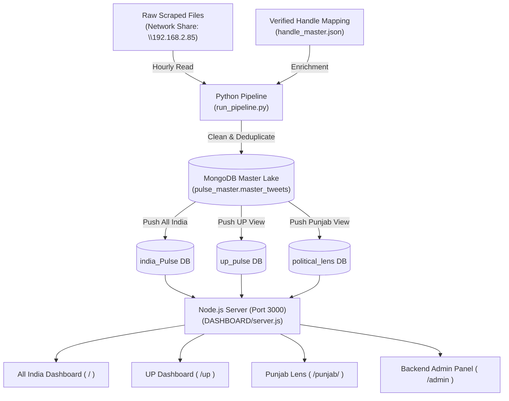
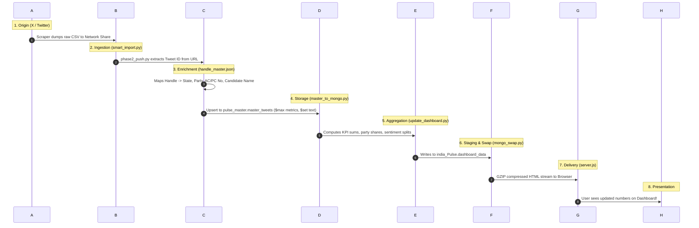

# India Political Pulse — Yeh Kaise Kaam Karta Hai (How It Works)

> **Kiske liye hai:** Naye developers, analysts, product managers, ya non-technical team members jo 15 minute mein poora system aasaani se samajhna chahte hain.  
> **Source Code Path:** `c:\Main Twitter Project`  

---

## 1. Yeh Dashboard Kya Hai?

**India Political Pulse** ek real-time social media intelligence platform hai jo Twitter (X) par chal rahi poori Indian politics ko track aur analyse karta hai.
- **Kis liye bana hai:** Desh bhar ke 16+ lakh tweets, hazaron netaon (CM, Dy CM, MP, MLA, Candidates) aur bade media houses/patrakaron ke tweets ko ek jagah laane ke liye.
- **Kaun use karta hai:** Political consultants, campaign strategists, data analysts aur election management teams.
- **Kya problem solve karta hai:** Pehle alag-alag Excel files mein bikhra hua data dekhna mushkil hota tha. Yeh platform sabhi raw files ko automate karke ek hi jagah All-India, Uttar Pradesh aur Punjab ka live dashboard bana deta hai, jahan pata chalta hai ki kis party ka sentiment kaisa hai, kaun sa neta kitna viral hai, aur log kis mudde par charcha kar rahe hain.

---

## 2. Yeh Kaise Bana Hai?

### A. Tech Stack (Aasan Bhasha Mein)

- **Frontend (Screen par jo dikhta hai):** Pure HTML5, CSS3 aur Vanilla JavaScript. Koi heavy framework (React ya Angular) nahi hai, isliye browser par bina kisi lag ke turant khulta hai. Maps ke liye GeoJSON vectors use hote hain.
- **Backend (Peeche ka dimaag):** 
  - **Node.js (Express):** Server chalata hai (Port 3000), login verify karta hai, aur data ko compress karke browser ko bhejta hai.
  - **Python (3.10+):** Heavy data processing, network se CSV/Excel files padhna, data saaf karna (cleaning), sentiment jurna, aur database mein save karna.
- **Database (Data kahan rehta hai):** **MongoDB Community Server**. Isme 4 alag-alag databases hain: ek raw data lake (`pulse_master`), aur teen read-only datamarts (`india_Pulse`, `up_pulse`, `political_lens`).
- **External Services (Bahar ki cheezein):**
  - **Groq Cloud AI:** AI Assistant jo dashboard ke numbers padh kar sawalon ke direct jawab deta hai.
  - **Twitter / X GraphQL:** Naye tweets live fetch karne ke liye.
  - **ngrok:** Local server ko internet par securely share karne ke liye (public URL).

### B. Har Bade Folder Ka Kaam (Ek-Ek Line Mein)

| Folder | Kaam |
| :--- | :--- |
| `DASHBOARD/` | Main control room: Express server (Port 3000), All-India dashboard, pipeline scripts, aur Admin panel. |
| `UP-DASHBOARD/` | Uttar Pradesh specific subsystem: UP ki assembly seats, district maps, aur UP-filtered reports. |
| `PunjabLens/` | Punjab specific subsystem: Punjab ke neta, partiyan (AAP, SAD, INC, BJP) aur mudde dikhane wala standalone engine. |
| `mongo_dump_py/` | Database ke JSON backups aur disaster recovery dumps. |
| `Reports/` | Historical daily HTML reports aur generated summaries ka folder. |

### C. System Architecture Diagram



---

## 3. Yeh Kaise Kaam Karta Hai (Start Se End Tak)

### Step 1: App Start Hone Par Kya Hota Hai?
1. User jab `START_LIVE.bat` double-click karta hai, toh script sabse pehle Windows MongoDB service ko start karta hai (`net start MongoDB`).
2. Port 3000 par agar koi purana atka hua process hai toh use kill karta hai.
3. Node server `server.js` background mein start hota hai aur MongoDB connection pool bana leta hai.
4. Agar `ngrok` available hai toh public HTTPS link create ho jata hai.
5. Browser khud-ba-khud `http://localhost:3000` par khul jata hai.
6. Har 1 ghante (3600 seconds) mein background loop `run_pipeline.py` ko trigger karta hai taaki naya data sync hota rahe.

### Step 2: User Login Karta Hai Toh Kya Hota Hai?
1. User login page (`/login`) par email aur password daalta hai.
2. `auth_lib.js` pehle check karta hai ki kahin brute-force attack (lagatar galat password) toh nahi ho raha.
3. Password ko `crypto.scryptSync` se verify kiya jata hai.
4. Login successful hone par ek signed cookie (`pulse_auth`) browser ko milti hai: `role~email.timestamp.signature`.
5. User ke role ke hisaab se use sahi page par redirect kiya jata hai:
   - `admin` -> All India Dashboard (`/`)
   - `up` -> UP Dashboard (`/up`)
   - `punjab` -> Punjab Dashboard (`/punjab/`)
   - `backend` -> Admin Console (`/admin`)

### Step 3: Screen Par Data Kaise Aata Hai?
- Jab dashboard khulta hai, toh server MongoDB se pre-computed data (`dashboard_data.json`) ko uthata hai aur HTML template ke andar inject kar deta hai.
- Node.js ka `zlib` stream is 6MB ke page ko compress karke sirf **1.6MB** bana deta hai, jisse page ek jhatke mein load ho jata hai.
- Browser mein aate hi vanilla JavaScript client-side memory se graphs, charts, aur tables render kar deta hai.

### Real Example: "User Ne X Button Dabaya Toh Kya Hua?"
**Scenario: Admin ne kisi naye politician ka Twitter handle track karne ke liye submit kiya:**
1. **Button Click:** Admin ne `/admin` panel par jakar `@NewLeaderUP` handle daala aur **"Add Handle"** button dabaya.
2. **API Call:** Browser ne `POST /admin/tracker/add` endpoint ko request bheji (`DASHBOARD/server.js`).
3. **Database Write:** Server ne `pulse_master.tracked_handles` collection mein record insert kiya (`{ _id: 'NewLeaderUP', active: true }`).
4. **Scraper Action:** `x_scraper.js` ne Twitter GraphQL API se us handle ke pichhle 72 ghante ke tweets fetch kiye.
5. **Mapping Gate:** `mapping_lib.js` ne check kiya ki handle mapping list mein hai ya nahi:
   - Agar mapped hai: `pulse_master.master_tweets` mein seedha upsert ($max for views, $set for text).
   - Agar unmapped hai: `pulse_master.pending_tweets` mein hold par chala gaya jab tak admin use party aur constituency assign na kar de.
6. **Screen par kya dikha:** Admin panel par "Handle Added Successfully" ka notification aaya aur Scraper logs mein realtime rows count update ho gaya.

---

## 4. Yeh Kya-Kya Tasks Perform Karta Hai?

| Task / Feature | Kaun Trigger Karta Hai | Kaun Si File / Function | Kaun Si Collection Touch Hoti Hai | Result / Output |
| :--- | :--- | :--- | :--- | :--- |
| **Hourly Network Ingestion** | Background loop (`START_LIVE.bat`) | `run_pipeline.py` -> `phase2_push.py` | `pulse_master.master_tweets` | Network folder se nayi files scan hokar master lake mein merge ho jaati hain. |
| **All-India Data Push** | Pipeline ya manual CLI | `update_dashboard.py` | `india_Pulse.dashboard_data`, `handles`, `phd` | All-India view ka data zero-downtime rename ke saath taaza ho jata hai. |
| **UP Data Push** | Pipeline ya manual CLI | `UP-DASHBOARD/update_dashboard.py` | `up_pulse.dashboard_data`, `tweets` | UP constituency map aur report search pool update hota hai. |
| **Punjab Data Push** | Pipeline ya manual CLI | `PunjabLens/build_punjab_data.py` | `political_lens.aggregates`, `tweets` | PunjabLens dashboard ka data refresh hota hai. |
| **Live Handle Scraping** | Admin button ya 30-min timer | `x_scraper.js` -> `run()` | `pulse_master.tracked_handles`, `master_tweets` | Naye tweets live X GraphQL API se master pool mein aa jaate hain. |
| **Breaking News Extraction** | User view karta hai (`/api/news`) | `news_lib.js` -> `categorise()` | `pulse_master.master_tweets` | 3.25L media tweets mein se 14 categories (Elections, Crime, etc.) mein news sort hoti hai. |
| **AI Narrative Assistant** | User chatbot mein sawal puchhta hai | `server.js` -> `groqChat()` | Koi DB query nahi (Sirf pre-computed stats JSON) | Groq LLaMA 3.3 model 4-6 lines mein direct factual answer deta hai. |
| **Daily Report Generation** | Daily pipeline finish par | `daily_report.py` | `pulse_master.master_tweets` | `daily_report_YYYY-MM-DD.html` file banti hai jisme din bhar ka summary hota hai. |
| **Month-wise CSV Backup** | Daily pipeline finish par | `run_pipeline.py` -> `backup_csv()` | `pulse_master.master_tweets` | `master_YYYY-MM.csv` files network backup drive par safe write hoti hain. |
| **Handle Request Submission** | Dashboard user form submit karta hai | `POST /api/handle-request/submit` | `pulse_master.access_requests` | Admin panel mein approval ke liye request dikhne lagti hai. |
| **Date-wise CSV Export** | Client portal user | `portal.js` (Port 4000) | `pulse_master.master_tweets` | Filtered date range ki clean CSV file stream hokar download hoti hai. |

---

## 5. MongoDB Mein Data Kaise Store Hota Hai?

### Collections Ka Kaam (Ek-Ek Line Mein)

- **`pulse_master.master_tweets`**: Poore project ka single source of truth; 16+ lakh tweets numeric Tweet ID ke sath deduplicated.
- **`pulse_master.portal_users`**: Users ke login credentials, roles aur scrypt encrypted passwords.
- **`pulse_master.login_log`**: Security audit trail (kisne, kab, kis IP se login kiya ya galat password daala).
- **`pulse_master.x_profiles`**: Twitter profiles ka cache (bio, avatar photo, verified status, followers).
- **`pulse_master.tracked_handles`**: Admin scraper ke active aur inactive handles ki list.
- **`india_Pulse.dashboard_data`**: All-India dashboard ke pre-computed JSON blobs (cards, totals, graphs).
- **`india_Pulse.handles`**: All-India verified politicians ki ranked list (views, score, level ke saath).
- **`india_Pulse.phd`**: Party-Hourly-Daily numbers client-side charts ke liye.
- **`up_pulse.dashboard_data`**: UP specific assembly seat aur district-level precomputed data.
- **`up_pulse.tweets`**: UP aur media tweets ka pool jo `/api/report` mein keyword search chalata hai.
- **`political_lens.aggregates`**: Punjab dashboard ke ready-made data blocks.

### Ek Tweet Ka Poora Lifecycle (Kahan Se Aaya -> Kahan Dikha)



---

## 6. Roles Aur Permissions

| User Role | Kaun Sa Dashboard Khulta Hai? | Kya Dekh Sakta Hai? | Kya Nahi Dekh Sakta? |
| :--- | :--- | :--- | :--- |
| **`admin`** | All India (`/`) | Desh ka poora data, UP view, Punjab view, Admin panel, CSV download, Scraper control. | Koi restriction nahi hai (Full Superuser). |
| **`all`** | All India (`/`) | Pan-India overview, Chief Ministers map, All-India leaders leaderboard, breaking news. | UP constituency details, PunjabLens, aur Admin panel. |
| **`up`** | Uttar Pradesh (`/up`) | UP district maps, Vidhan Sabha constituency metrics, UP netaon ki ranking, UP reports. | All-India master views, PunjabLens, aur Admin panel. |
| **`punjab`**| Punjab Lens (`/punjab/`) | Punjab specific parties (AAP, SAD, INC), Punjab leaders, regional topics aur issues. | All-India dashboard, UP dashboard, aur Admin panel. |
| **`backend`**| Admin Panel (`/admin`)| Raw master tweets CSV exporter, daily reports status, mapping sync, hashtag tracker. | Standard visual executive charts (agar dual role na ho). |

---

## 7. Kya Cheez Kis Par Depend Karti Hai?

1. **Network Share (`\\192.168.2.85`)**: Agar scraping machine ka Wi-Fi/LAN disconnected hai ya IP badal gayi, toh pipeline ko nayi files nahi milengi (purana data dashboard par chalta rahega, naya nahi aayega).
2. **MongoDB Local Service (`port 27017`)**: Database agar band hai (`net start MongoDB` nahi chala), toh server HTTP 500 error dega.
3. **Groq Cloud API Key**: `DASHBOARD/ai_config.json` mein key na hone par AI narrative assistant error dega; baaki poora dashboard bina AI ke normal chalega.
4. **Twitter Cookies (`x_config.json`)**: Agar Twitter cookies expire ho jayein, toh in-process live scraper 401 Unauthorized dega; network ingestion tab bhi chalta rahega.
5. **Node.js LTS (v18+)**: Asynchronous gzip aur modern fetch APIs ke liye Node 18 zaroori hai.

---

## 8. Local Mein Kaise Chalayein? (Step-by-Step)

Koi bhi naya developer apne system par is project ko 3 steps mein chalu kar sakta hai:

### Step 1: Dependencies Install Karo (Ek Baar)
CMD kholo aur project ke root folder mein jao:
```cmd
cd /d "C:\Main Twitter Project"

REM Python packages
python -m pip install pymongo pandas openpyxl playwright textblob

REM Node packages
cd DASHBOARD
npm install
cd ..\PunjabLens
npm install
cd ..
```

### Step 2: Database Restore Karo (Agar Fresh Laptop Hai)
```cmd
python mongo_backup.py --restore
```
*(Check karne ke liye: `python RESET_MONGO.py --list` chalayein, docs count dikh jayega).*

### Step 3: Ek Double-Click Mein Chalao
```cmd
cd DASHBOARD
START_LIVE.bat
```
- Browser khud khulega: `http://localhost:3000`
- Login credentials:
  - **Email:** `admin@jarvis.consulting`
  - **Password:** `admin@Jarvis`

---

## 9. Limitations Aur Unclear Cheezein (Code Ke Basis Par)

Code padhne par jo kamiyan ya ajeeb cheezein saamne aayi hain:

1. **Hardcoded Passwords (`DASHBOARD/server.js` lines 110-116):**
   - Code mein 5 main accounts ke passwords plain-text likhe hue hain. Halanki `auth_lib.js` mein modern scrypt encryption maujood hai, phir bhi hardcoded fallback dictionary code mein chhoot gayi hai.
2. **Hardcoded Machine IP (`DASHBOARD/phase2_push.py` line 27):**
   - Network path `\\192.168.2.85\d\...` seedha code mein likha hai. Agar network ka IP router restart par badal gaya, toh pipeline bina kisi file ke exit kar jayega.
3. **5,200+ Lines Ka Ek Hi File (`DASHBOARD/server.js`):**
   - Ek hi file ke andar server setup, routes, HTML string templates, scraper logic, aur admin actions sab kuch mix hai. Ise alag-alag route controllers mein todna chahiye.
4. **Heavy Initial HTML Payload:**
   - Pre-computed JSON ko HTML ke andar hi chipkane ki wajah se file 6MB ki ho jaati hai (gzip ke baad 1.6MB). Purane mobile phones par DOM render hone mein 1-2 second ka pause aata hai.
5. **Standalone Portal User Disconnect (`DASHBOARD/portal.js`):**
   - Port 4000 par chalne wala Data Portal apne alag hardcoded users rakhta hai aur `pulse_master.portal_users` se sync nahi hai.
