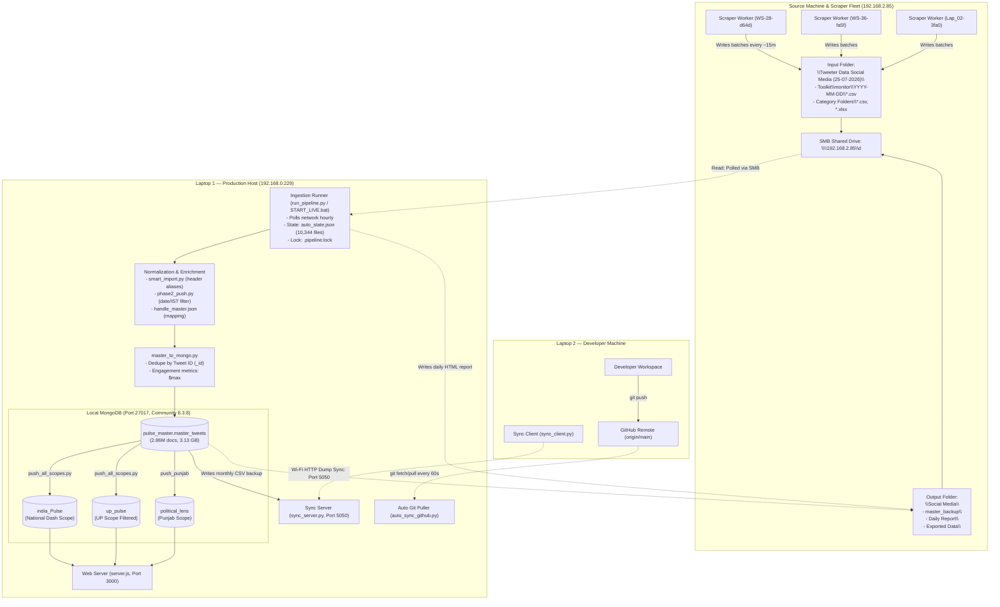

# Political Pulse — Network Data Source & Dependency Investigation

**Document:** `NETWORK_DATA_SOURCE_INVESTIGATION.md`  
**Investigation Target:** Network Data Source (`\\192.168.2.85\d\...`) & Laptop 1 Dependencies  
**Environment:** Laptop 1 (`DESKTOP-L6LFLP5`, Windows, IP: `192.168.0.229`)  
**Repository:** `c:\Main Twitter Project`  
**Mode:** READ-ONLY Forensic Investigation on Laptop 1

---

## 1. System Architecture Diagram

---

## 2. Reconstructed Data-Transfer Workflow

### 2.1 File Formats & Layout Arriving in the Share

Analysis of Laptop 1's state tracking database ([`auto_state.json`](file:///c:/Main%20Twitter%20Project/DASHBOARD/auto_state.json)), which records **10,344 processed files**, reveals the exact data layout in `\\192.168.2.85\d\Tweeter Data Social Media (25-07-2026)`:

| Subfolder Path | File Count | Formats | Naming Pattern & Purpose |
| :--- | :---: | :---: | :--- |
| `Toolkit\monitor\YYYY-MM-DD\` | **9,523** | `.csv` | High-frequency scrape batches: `monitor_<WORKER>_<YYYYMMDD>_b<BATCH>.csv` (e.g. `monitor_WS-28-d64d_20261023_b0045.csv`). Small files (5 KB – 45 KB). |
| `Toolkit\monitor\` | **3** | `.xlsx` | Daily consolidated workbook: `monitor_YYYY-MM-DD.xlsx` (e.g. `monitor_2026-10-23.xlsx`, 2.44 MB). |
| `ALL MAPPING\` | **221** | `.csv`, `.xlsx` | Historical handle and batch mapping dumps (`aLL.csv`, `monitor_Lap_02-3fa0_20260908_b0001.csv`). |
| `All India Top Leaders\` | **141** | `.csv` | Daily category dumps: `ALL PARTY (TOP LEADERS) TWITTER ACCOUNT Handle Tracking (YYYY-MM-DD).csv` (1.8 MB – 6.4 MB). |
| `CM and DCM\` | **111** | `.csv` | Daily category dumps: `CM and Dputy_CM (YYYY-MM-DD).csv` (350 KB – 1.7 MB). |
| `Media Houses\` | **96** | `.csv` | Daily category dumps: `Media Houses (YYYY-MM-DD).csv` (2.5 MB – 3.2 MB). |
| `UP_MLA\` | **76** | `.csv`, `.xlsx` | Uttar Pradesh MLA dumps: `UP_MLA_TWITTER ACCOUNT Handle Tracking (YYYY-MM-DD).csv` (1.2 MB – 25 MB). |
| `BJP SANGATHAN\` | **65** | `.csv` | Sangathan dumps: `BJP SANGATHAN TWITTER ACCOUNT (YYYY-MM-DD).csv` (1.4 MB – 51 MB). |
| `UttarPradeh data\` | **57** | `.csv` | Legacy UP dumps: `All Party Leader UP Twitter Handle Tracking (YYYY-MM-DD).csv` (1.0 MB – 35 MB). |
| `ALL INDIA ALL PARTY MLAs Twitter\` | **43** | `.csv` | Historical MLA batch archives (1.3 MB – 211 MB). |
| `UP_MP\` | **3** | `.csv`, `.xlsx` | Historical UP MP data dumps. |
| `journalist\` | **2** | `.csv`, `.xlsx` | Journalist profile tracking dumps. |
| **Total** | **10,344** | **10,296 .csv / 48 .xlsx** | **92.1% of all files are in `Toolkit\monitor\`** |

### 2.2 Publishing Pattern: Direct Generation vs. Copy

1. **High-Frequency Batch Generation (Active Workflow):**
   - In `Toolkit\monitor\2026-10-23\`, sequential batches appear every **14 to 16 minutes** (e.g. batch `b0032` at 12:37, `b0033` at 12:52, `b0035` at 13:10, `b0036` at 13:24, ..., `b0045` at 17:50).
   - This strict 15-minute cadence proves an **automated scheduled daemon/cron process** generating incremental batches directly or syncing them on completion.
2. **Batch Naming Tokenization:**
   - The token `WS-28-d64d`, `WS-36-fa5f`, and `Lap_02-3fa0` identifies specific worker nodes or scraper instances.
3. **Appended vs. Overwritten:**
   - **Batch files are never overwritten; they are new, append-only files.** Each run outputs a new batch suffix (`_b0042.csv`, `_b0043.csv`, etc.).
   - Consolidated workbooks (`monitor_YYYY-MM-DD.xlsx`) grow throughout the day as daily summaries are compiled.

---

## 3. Script Dependency Matrix on the Network Shared Folder

Below is every script and configuration file on Laptop 1 that depends on the network share:

| Script / Component | Purpose | Mode | Change Detection Method | Frequency | Failure Behavior (Share Down) | Risk of Missed / Duplicate Data | Code Reference |
| :--- | :--- | :---: | :--- | :---: | :--- | :--- | :--- |
| [`DASHBOARD/run_pipeline.py`](file:///c:/Main%20Twitter%20Project/DASHBOARD/run_pipeline.py) | Master pipeline orchestrator. Discovers new files, ingests to Mongo, triggers scope recomputation, writes backups. | **READ & WRITE** | `os.stat()` comparing `(mtime, size)` against `auto_state.json`. | Hourly (in `START_LIVE.bat` loop) | Exits cleanly (`log("!! network folder nahi mila")`). Skips run. | **Zero data loss or duplicates.** Resumes from last saved state once share is back. | [`run_pipeline.py:389-412`](file:///c:/Main%20Twitter%20Project/DASHBOARD/run_pipeline.py#L389-L412), [`run_pipeline.py:34`](file:///c:/Main%20Twitter%20Project/DASHBOARD/run_pipeline.py#L34) |
| [`DASHBOARD/phase2_push.py`](file:///c:/Main%20Twitter%20Project/DASHBOARD/phase2_push.py) | File scanner and row-level normalizer. Reads files, maps columns via `smart_import.py`. | **READ** | `os.walk(BASE)` scanning for `*.csv`, `*.xlsx`, `*.xls`, `*.xlsm`. | Invoked by `run_pipeline.py` & `auto_update.py` | `os.walk` returns empty list if directory is missing. | None. Skips locked or partial files (`try/except`). | [`phase2_push.py:27`](file:///c:/Main%20Twitter%20Project/DASHBOARD/phase2_push.py#L27), [`phase2_push.py:92-110`](file:///c:/Main%20Twitter%20Project/DASHBOARD/phase2_push.py#L92-L110) |
| [`DASHBOARD/auto_update.py`](file:///c:/Main%20Twitter%20Project/DASHBOARD/auto_update.py) | Alternative/legacy updater for All-India and UP scopes. | **READ** | `find_new(state)` checking `mtime` and `size`. | Manual or legacy runner | Returns with error message if `P2.BASE` is not a dir. | None. Uses same deduplication as `run_pipeline`. | [`auto_update.py:62-63`](file:///c:/Main%20Twitter%20Project/DASHBOARD/auto_update.py#L62-L63) |
| [`DASHBOARD/daily_report.py`](file:///c:/Main%20Twitter%20Project/DASHBOARD/daily_report.py) | Generates HTML daily scraping summary report. | **READ & WRITE** | Reads `BASE`, writes HTML to `OUTDIR` (`\\192.168.2.85\d\Social Media\Daily Report`). | Daily / End of pipeline | Fails file write if share is down; logs exception. | Cosmetic only. Daily report file is not written to network. | [`daily_report.py:21-22`](file:///c:/Main%20Twitter%20Project/DASHBOARD/daily_report.py#L21-L22) |
| [`DASHBOARD/export_csv.py`](file:///c:/Main%20Twitter%20Project/DASHBOARD/export_csv.py) | Exports full master dataset to CSV on network. | **WRITE** | Manual execution | On demand | Aborts with `IOError` if path unavailable. | None. Export operation only. | [`export_csv.py:25`](file:///c:/Main%20Twitter%20Project/DASHBOARD/export_csv.py#L25) |
| [`DASHBOARD/export_from_mongo.py`](file:///c:/Main%20Twitter%20Project/DASHBOARD/export_from_mongo.py) | Exports date-filtered tweets from Mongo to network folder. | **WRITE** | Manual execution | On demand | Logs warning and falls back to local directory. | None. Export operation only. | [`export_from_mongo.py:29`](file:///c:/Main%20Twitter%20Project/DASHBOARD/export_from_mongo.py#L29) |
| [`DASHBOARD/GET_DATA.py`](file:///c:/Main%20Twitter%20Project/DASHBOARD/GET_DATA.py) | CLI utility to extract subsets for analytical reporting. | **WRITE** | Manual execution | On demand | Fails file save if path unavailable. | None. | [`GET_DATA.py:12`](file:///c:/Main%20Twitter%20Project/DASHBOARD/GET_DATA.py#L12) |
| [`DASHBOARD/check_missing_tweets.py`](file:///c:/Main%20Twitter%20Project/DASHBOARD/check_missing_tweets.py) | Quality audit script comparing files on `BASE` against Mongo. | **READ** | Diagnostic tool | On demand | Exits with error if `BASE` is unreachable. | Read-only diagnostic. | [`check_missing_tweets.py:41`](file:///c:/Main%20Twitter%20Project/DASHBOARD/check_missing_tweets.py#L41) |
| [`DASHBOARD/backfill_source_folder.py`](file:///c:/Main%20Twitter%20Project/DASHBOARD/backfill_source_folder.py) | Diagnostic script to backfill `Source Folders` field from network tree. | **READ** | Diagnostic tool | On demand | Exits if `BASE` is unreachable. | Read-only scan before updating Mongo. | [`backfill_source_folder.py:39`](file:///c:/Main%20Twitter%20Project/DASHBOARD/backfill_source_folder.py#L39) |
| [`DASHBOARD/rebuild_3_july.py` & `rebuild_4_media.py`](file:///c:/Main%20Twitter%20Project/DASHBOARD/rebuild_3_july.py) | Disaster recovery scripts to rebuild July/Media data from network folders. | **READ** | One-time rebuild | One-time | Fails if folders are missing. | None (only run during initial bootstrap). | [`rebuild_3_july.py:30-36`](file:///c:/Main%20Twitter%20Project/DASHBOARD/rebuild_3_july.py#L30-L36) |
| [`COMMANDS.md`](file:///c:/Main%20Twitter%20Project/COMMANDS.md) & [`setup.py`](file:///c:/Main%20Twitter%20Project/setup.py) | System documentation and setup script. | **CHECK** | Documents `net use \\192.168.2.85\d /persistent:yes` | One-time setup | Informs user to verify share mount. | Documentation. | [`COMMANDS.md:93-99`](file:///c:/Main%20Twitter%20Project/COMMANDS.md#L93-L99), [`setup.py:235`](file:///c:/Main%20Twitter%20Project/setup.py#L235) |

---

## 4. Machine Identity & Topology Mapping

| Entity | Verified Network Identity | Operational Role | Hardware / Software Fingerprint | Evidence from Laptop 1 |
| :--- | :--- | :--- | :--- | :--- |
| **Laptop 1** | Hostname: `DESKTOP-L6LFLP5` IP: `192.168.0.229` OS: Windows | **Primary Production Host**. Runs local MongoDB (8.3.8), `run_pipeline.py`, Web Dashboard (`server.js`), and `sync_server.py`. | Intel Core i5-1135G7 (4 cores / 8 threads), 8 GB RAM, `role: "primary"` in `local_config.json`. | Verified via OS hardware query, [`local_config.json`](file:///c:/Main%20Twitter%20Project/DASHBOARD/local_config.json), and [`sync_client.py:5`](file:///c:/Main%20Twitter%20Project/sync_client.py#L5). |
| **Laptop 2** | Unknown hostname Client on Wi-Fi subnet `192.168.0.x` | **Development Machine**. Used for code authoring. Runs `sync_client.py` to pull DB dumps over Wi-Fi from Laptop 1; pushes code to GitHub. | Runs `sync_client.py http://192.168.0.229:5050`. Configured as `role: "secondary"`. | Verified via [`sync_client.py:2-41`](file:///c:/Main%20Twitter%20Project/sync_client.py#L2-L41) and [`PROJECT_ANALYSIS.md:580`](file:///c:/Main%20Twitter%20Project/PROJECT_ANALYSIS.md#L580). |
| **Share Host Computer** | IP: `192.168.2.85` Share: `\\192.168.2.85\d` | **Network Shared Storage Server**. Hosts `D:` drive containing raw tweet dumps and backups. | Windows SMB file server on subnet `192.168.2.x`. Routed across office router to Laptop 1 (`192.168.0.x`). | Verified via UNC paths across 12 scripts and [`COMMANDS.md:93`](file:///c:/Main%20Twitter%20Project/COMMANDS.md#L93). |
| **Scraper Worker Nodes** | Worker IDs in files: - `WS-28-d64d` - `WS-36-fa5f` - `Lap_02-3fa0` | **Scraper Fleet / Worker Nodes**. Perform automated X/Twitter scraping and publish batch files. | Output naming: `monitor_<WORKER>_<DATE>_b<BATCH>.csv`. | Verified via 9,523 filenames in [`auto_state.json`](file:///c:/Main%20Twitter%20Project/DASHBOARD/auto_state.json). Whether these run directly on `192.168.2.85` or write across the LAN is unverified from Laptop 1. |

---

## 5. Operational Risk Assessment

| Scenario | Code Behavior on Laptop 1 | Database / Dashboard Impact | Recovery Path |
| :--- | :--- | :--- | :--- |
| **Network Share Unavailable** | `run_pipeline.py:389` checks `os.path.isdir(P2.BASE)`. Logs `!! network folder nahi mila` and terminates the run gracefully. | **Zero database corruption.** Existing dashboard continues serving existing data. No new tweets ingested. | Automatically resumes on the next hourly cycle once `\\192.168.2.85` is reachable. |
| **Source Machine Stops Publishing** | `find_new(state)` discovers 0 new files. Logs source freshness and enters `added == 0 -> push skip`. | **Zero load spike.** Push to scopes is skipped. Dashboards remain active on current snapshot. | As soon as scraper resumes writing files, `find_new` picks them up by `mtime`. |
| **File Read While Being Written** | Writer file-lock triggers `PermissionError`/`OSError`, caught by `phase2_push.py:116` (`try/except`). If unbuffered, `smart_import.py` skips corrupt rows with `on_bad_lines='skip'`. | Because state is not saved until full run success, the file is re-scanned on the next cycle when size/mtime change. | `master_to_mongo.py` deduplicates by `Tweet ID` (`_id`) and applies `$max` on metrics. No duplicate tweets created. |
| **File Modified Without Size Changing** | `find_new(state)` checks `(mtime == mt and size == sz)`. A content edit updates file `mtime`. | `mtime != mt` triggers re-read. Ingestion updates existing document attributes via `$set` and metrics via `$max`. | Automatic. No manual intervention needed. |
| **Laptop 1 Restarts** | Neither `START_LIVE.bat` nor `server.js` starts automatically (not in Task Scheduler). State on disk is intact. | Web dashboard stays offline until batch file is manually launched. | Run `START_LOCAL.bat` or `START_LIVE.bat`. Stale lock file `.pipeline.lock` is self-cleared if PID is dead. |
| **Laptop 2 Pushes Code Changes** | If `auto_sync_github.py` is running, it polls `origin/main` every 60s and pulls updates. | Python pipeline reloads modules (`importlib.reload(PA)`) dynamically every hour, immediately adopting changes. | If code contains a syntax bug, pipeline fails safely without corrupting MongoDB data. |

---

## 6. Development Feasibility: Hot/Cold Storage Without Source Computer

### 1. Can we understand the complete pipeline from Laptop 1 alone?
**YES.** Laptop 1 contains the complete consumption codebase, schema normalization logic, deduplication rules, database indexing, scope build scripts, and delivery server. The boundary between the source computer and Laptop 1 is strictly a **file-based contract** over SMB.

### 2. What can be verified now?
- Full schema requirements (`Tweet URL`, `Tweet Date`, `Tweet ID`, `Handle`, `Party`, `Total Likes`, `Total Views`, etc.).
- The exact deduplication rule (`_id = Tweet ID`, `$max` on numeric engagement, `$set` on text, `$setOnInsert` on `_first`).
- The rate of incoming data: ~15-minute batches averaging ~20 MB to 25 MB of new tweets daily.
- All 10,344 historical file paths and their directory hierarchy.

### 3. What cannot be verified without inspecting the source computer?
- The internal scraping scripts or automation tools running on `192.168.2.85`.
- Whether `192.168.2.85` has an automatic disk cleanup script that purges old `.csv` files after X months.
- Why network share `\\192.168.2.85` went offline on 23-Oct-2026.

### 4. Can Hot/Cold Storage be developed and tested separately without interrupting the existing pipeline?
**YES, 100% SAFELY.**
- **Isolation:** Hot/Cold storage is an internal database architecture concern on Laptop 1.
- **Implementation Strategy:**
  1. The pipeline writes to `pulse_master.master_tweets`. Hot/Cold logic can be implemented either as an automated background archival job (moving tweets older than 30 days to `pulse_master.master_tweets_cold`) or as date-partitioned collections.
  2. Scope compilation (`push_all_scopes.py`) only queries tweets needed for dashboard analytical windows (7-day, 30-day, full-scope). It can query the "Hot" collection directly, dramatically reducing query times and memory usage.
  3. Testing can be done on cloned collections (e.g. `test_master_hot` / `test_master_cold`) without modifying the live collections or touching the network source share.

### 5. What minimum information is eventually needed from the source computer?
Only **two basic operational confirmations**:
1. Restoration and static availability of the network share `\\192.168.2.85\d`.
2. Confirmation that scraper workers do not retroactively modify historical `.csv` files from previous months without updating file modification timestamps.

---

## 7. Categorized Evidentiary Breakdown

### A. Verified Facts (Proven from Laptop 1 Code & Logs)
1. **Network Path:** `BASE` is hardcoded as `\\192.168.2.85\d\Tweeter Data Social Media (25-07-2026)` across 12 independent project scripts.
2. **Reverse Flow (Laptop 1 -> Share):** Laptop 1 writes monthly master CSV backups to `\\192.168.2.85\d\Social Media\master_backup` and daily reports to `\\192.168.2.85\d\Social Media\Daily Report`.
3. **Change Detection:** Laptop 1 tracks file ingestion exclusively via `(mtime, size)` in `auto_state.json`.
4. **Current Status:** Ingestion halted on 23-Oct-2026 at 20:03 because `os.path.isdir(BASE)` returned `False` (`!! network folder nahi mila`).
5. **Laptop Roles:** Laptop 1 has `role: "primary"` in `local_config.json`. Laptop 2 is designated `role: "secondary"` and pulls DB dumps from Laptop 1 via `sync_client.py http://192.168.0.229:5050`.

### B. Working Hypotheses / Highly Probable Inferences
1. **Scraper Fleet Architecture:** The filename prefixes `WS-28-d64d`, `WS-36-fa5f`, and `Lap_02-3fa0` strongly indicate multiple scraping machines or headless worker containers dumping batch files into `192.168.2.85\d` over the LAN.
2. **Subnet Routing:** Laptop 1 is on Wi-Fi `192.168.0.x` while the file server is on `192.168.2.x`. They communicate via an office multi-subnet router. The outage on 23-Oct may be an IP lease change, Wi-Fi band change, or the server machine being powered down.

### C. Unknowns (Unverifiable from Laptop 1 Alone)
1. Whether `192.168.2.85` is a Windows desktop, a Windows Server, or a Linux Samba NAS.
2. The exact scraping software or scripts generating the `Toolkit\monitor\` files.
3. Whether older batch files in `Toolkit\monitor\` are archived or deleted periodically by the source machine.

---

## 8. Safest Next Steps (Ordered by Priority)

1. **Verify / Restore Network Path Connectivity:**
   - Run `Test-NetConnection 192.168.2.85` or verify if the machine at `192.168.2.85` is powered on and connected to the office network.
2. **Add Missing Index on `pulse_master.master_tweets`:**
   - Create `{ "_first": 1 }` index in MongoDB. As discovered in the inspection report, this resolves the 76-second `COLLSCAN` bottleneck on Laptop 1 during daily pipeline runs.
3. **Design Hot/Cold Storage Architecture on Laptop 1:**
   - Define collection boundaries: `master_tweets_hot` (last 30–60 days, fully indexed in RAM) and `master_tweets_cold` (historical archive).
   - Test partition swapping and benchmark query speeds locally on Laptop 1 using existing 2.86M records without altering production pipelines.
4. **Convert Ingestion Runner to Windows Scheduled Task:**
   - Move `START_LIVE.bat` into Windows Task Scheduler so the pipeline runs resiliently in the background even if user desktop sessions close or the laptop reboots.
