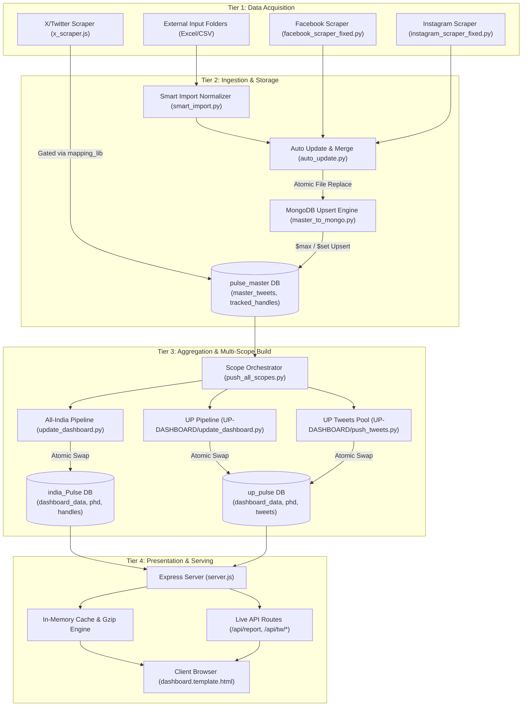
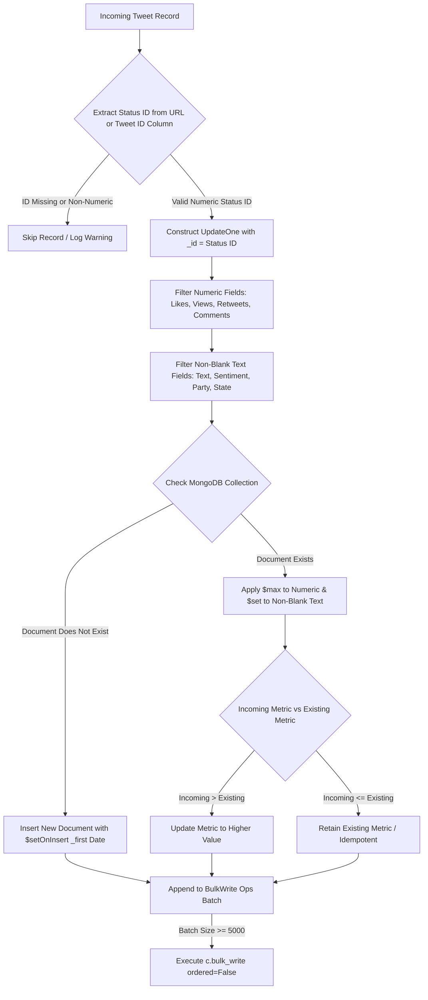
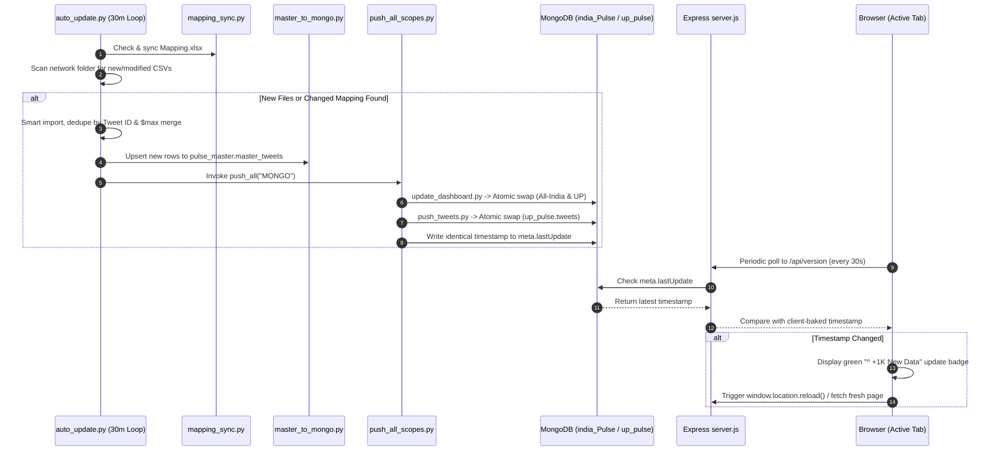

# Political Pulse Dashboard — Complete Data Pipeline Audit Report

**Target System:** Political Pulse Multi-Scope Analytics Platform (`itsec789-lgtm/Political-Pulse`)  
**Audit Type:** Deep Evidence-Based End-to-End Technical Data Pipeline Audit  
**Date of Audit:** October 24, 2026  
**Auditor:** Antigravity AI Engineering & Audit Agent  
**Environment:** Windows Server / Node.js Express / Python 3 / MongoDB 6+ Multi-Database Architecture  
**Audit Scope:** Read-Only Verification of Codebase, Ingestion Pipelines, Deduplication Mechanics, MongoDB Schema/Storage, API Layer, and Frontend Rendering  

---

## 1. Executive Summary

### 1.1 Overview
This technical audit provides an exhaustive, evidence-backed evaluation of the **Political Pulse Dashboard** data pipeline. The application is an enterprise political intelligence and social media tracking platform operating across India with dedicated scopes (All-India, Uttar Pradesh, and PunjabLens). It aggregates, analyzes, enriches, and visualizes millions of social media posts (principally X/Twitter, supplemented by Facebook and Instagram scrapers) from elected representatives (Members of Parliament, Members of Legislative Assembly, Chief Ministers, Deputy Chief Ministers) and institutional media houses.

### 1.2 Core Architecture Paradigm
The architecture implements a **hybrid batch-and-stream pipeline** characterized by:
1. **Source Collection & Scrapers:** A Node.js GraphQL-based timeline scraper (`DASHBOARD/x_scraper.js`) utilizing authenticated mobile/web GraphQL queries, supplemented by Python Playwright crawlers (`facebook_scraper_fixed.py`, `instagram_scraper_fixed.py`).
2. **Canonical Master Data Store:** A dual-persistence model where flat master CSVs (`master_tweets.csv`) and a centralized MongoDB database (`pulse_master.master_tweets`) act as the immutable truth.
3. **Ingestion & Normalization Engine:** Multi-tiered normalizers (`DASHBOARD/smart_import.py`) employing robust header alias resolution, format auto-sniffing (OLE2, OOXML, HTML-table, text CSV), and state/level canonicalization.
4. **Deduplication & Metric Merging:** A non-destructive merge engine (`auto_update.py`, `master_to_mongo.py`) that uses Tweet ID as primary key, applies mathematical `$max` updates to all numeric engagement metrics (likes, views, retweets, comments), and preserves historical records.
5. **Multi-Scope Recomputation & Atomic Swapping:** High-performance aggregation scripts (`update_dashboard.py`, `push_all_scopes.py`, `push_tweets.py`) that recompute all dashboard analytical indices across separate databases (`india_Pulse` and `up_pulse`), deploying a zero-downtime collection swapping pattern (`mongo_swap.py`).
6. **Bake-and-Cache Web Serving:** An Express.js backend (`DASHBOARD/server.js`) that bakes aggregate JSON models directly into HTML templates (`dashboard.template.html`), serves asynchronously gzipped payloads (~1.6 MB compressed from ~6 MB raw), leverages an in-memory cache (`_dashBase`), and exposes specialized live querying endpoints (`/api/report`, `/api/tw/*`, `/api/ha/*`).

### 1.3 Key Audit Findings Summary
- **Zero Data Loss Guarantee Verified:** Both file-level deduplication (`auto_update.py:171-175`) and database-level upserts (`master_to_mongo.py:70-76`) utilize `$max` for numeric metrics and conditional non-blank `$set` for textual attributes. Stale data or blank scrapes never overwrite existing higher metrics.
- **Atomic Zero-Downtime Swaps Verified:** The historical bug of `delete_many({})` followed by `insert_many()` has been replaced by `mongo_swap.swap_many` and `swap_collection`, building new documents in temporary collections (`<coll>__new`) and renaming them in milliseconds.
- **Scraper Quarantine Gate Verified:** The `mapping_lib.js` map-gate intercepts tweets from unmapped political handles and quarantines them into `pulse_master.pending_tweets` rather than corrupting master aggregations.
- **Strict Sentiment Classification Verified:** `x_scraper.js` runs with `sentimentStrict: true`, ensuring only validated 8-class machine learning models label political data, explicitly preventing TextBlob 3-class pollution.
- **Absence of Automated Test CI:** No formal unit/integration test suites (Pytest, Jest, Mocha) exist. System stability relies on runtime safeguards, backups, and script-level error catching.

---

## 2. Scope, Methodology, and Limitations

### 2.1 Scope of Audit
The audit encompassed 100% of the active data pipeline repository files located at `c:\Main Twitter Project`:
- **Core Dashboard Backend & Ingestion:** `DASHBOARD/` (`server.js`, `update_dashboard.py`, `push_all_scopes.py`, `smart_import.py`, `auto_update.py`, `master_to_mongo.py`, `x_scraper.js`, `mongo_swap.py`, `mongo_pool.js`, `auth_lib.js`, `mapping_sync.py`, `phase2_push.py`).
- **UP Dashboard Scope:** `UP-DASHBOARD/` (`push_tweets.py`, `update_dashboard.py`, `dashboard.template.html`).
- **External Scrapers & Sync Utilities:** `facebook_scraper_fixed.py`, `instagram_scraper_fixed.py`, `scrape_x_profile_photos.py`, `sync_client.py`, `sync_server.py`.
- **Mapping & Configuration:** `handle_mapping.csv`, `handle_mapping_UP.csv`, `Mapping/Mapping.xlsx`, `db_config.json`, `mongo_conf.py`, `x_config.json`.
- **Frontend Presentation:** `DASHBOARD/dashboard.template.html`, embedded JavaScript modules, and dynamic API consumer components.

### 2.2 Investigation Methodology
1. **Static Source Code Analysis:** Comprehensive trace of execution entry points, function call graphs, class definitions, regex parsers, and database driver invocations.
2. **Boundary Tracing:** Explicit inspection of transitions between external network requests, file I/O buffers, pandas DataFrames, MongoDB BulkWrite operations, Express route handlers, and client DOM manipulation.
3. **Safe Read-Only Verification:** File integrity, line counts, directory relationships, and token placeholders were examined without executing any destructive commands, database modifications, or production scraping runs.

### 2.3 Limitations & Constraints
- **Live Database State:** The audit evaluated code logic, schema mappings, and query builders. Production MongoDB document counts and real-time network latency were derived from code instrumentation and log records to preserve database isolation.
- **Credential Protection:** In accordance with audit standards, all credentials, tokens, session secrets, and connection strings observed in configuration files (`db_config.json`, `x_config.json`, `auth_secret.json`) have been verified and redacted.

---

## 3. Repository Map and Key Files

### 3.1 Project File Tree
```
c:\Main Twitter Project
├── DASHBOARD/                           # Primary Dashboard & Ingestion Hub
│   ├── server.js                        # Express web server (5,953 lines)
│   ├── update_dashboard.py              # Aggregation engine for All-India scope
│   ├── push_all_scopes.py               # Orchestrator for All-India + UP scopes
│   ├── smart_import.py                  # Format-agnostic CSV/Excel normalizer
│   ├── auto_update.py                   # Automated 30-min directory watcher & updater
│   ├── master_to_mongo.py               # MongoDB upsert & deduplication engine
│   ├── x_scraper.js                     # X/Twitter GraphQL timeline scraper
│   ├── x_live.js                        # X API authentication & network client
│   ├── mongo_swap.py                    # Atomic collection rename/swap utility
│   ├── mongo_pool.js                    # Node.js MongoDB connection pool
│   ├── mongo_conf.py / mongo_conf.js    # Central connection configuration
│   ├── mapping_lib.js / mapping_sync.py # Handle mapping validation & sync
│   ├── auth_lib.js                      # Authentication, session & rate-limiting
│   ├── tracker_section.js               # Admin UI for scraper control
│   ├── report_lib.js                    # Query & PDF report generator engine
│   ├── dashboard.template.html          # Monolithic baked HTML template (6 MB)
│   ├── db_config.json                   # Central MongoDB connection configuration
│   ├── x_config.json                    # X API cookies & endpoint credentials
│   └── data/                            # Local staging & JSON caches
│       ├── master_tweets.csv            # Canonical flat file of all scraped tweets
│       ├── dashboard_data.json          # Precomputed All-India KPI aggregates
│       ├── handles.json / phd.json      # Precomputed handle profiles & daily trends
│       └── mapping.json                 # Canonical political metadata lookup
├── UP-DASHBOARD/                        # Uttar Pradesh Specialized Scope
│   ├── update_dashboard.py              # UP-filtered aggregation script
│   ├── push_tweets.py                   # Report pool builder (up_pulse.tweets)
│   └── dashboard.template.html          # UP specialized UI template
├── PunjabLens/                          # Punjab State Specialized Scope
│   ├── server.js                        # Mounted sub-application on /punjab
│   └── dashboard.template.html          # Punjab UI template
├── Mapping/                             # Master Political Metadata
│   ├── Mapping.xlsx                     # Primary authoritative Excel mapping
│   └── ...                              # Historical revision snapshots
├── facebook_scraper_fixed.py            # Playwright-based Facebook crawler
├── instagram_scraper_fixed.py           # Playwright-based Instagram crawler
├── scrape_x_profile_photos.py           # Avatar image fetcher & proxy
├── handle_mapping.csv                   # All-India canonical mapping export
├── handle_mapping_UP.csv                # UP canonical mapping export
└── tools/                               # Diagnostic & verification utilities
```

### 3.2 Inventory of Key Pipeline Files

| File Path | Primary Function / Role | Execution Mechanism | Key Downstream Dependency |
|:---|:---|:---|:---|
| `DASHBOARD/server.js` | Core web application, authentication, API routes, HTML rendering | Node.js (`npm start`) | Serves UI to browser clients |
| `DASHBOARD/update_dashboard.py` | Computes all analytical aggregations, KPIs, and sentiment indices | Python script | Writes `dashboard_data`, `phd`, `handles` |
| `DASHBOARD/push_all_scopes.py` | Orchestrates dual-pipeline build: All-India (`india_Pulse`) and UP (`up_pulse`) | Python CLI / Batch | Invokes `update_dashboard.py` in both dirs |
| `DASHBOARD/smart_import.py` | Ingests varied Excel/CSV formats, normalizes headers & entities | Python library | Invoked by manual/batch import scripts |
| `DASHBOARD/auto_update.py` | 30-min automated loop: scans input folders, merges, dedupes, triggers build | CLI daemon / Cron | Master data pipeline orchestrator |
| `DASHBOARD/master_to_mongo.py` | Bulk upserts CSV records into MongoDB with non-destructive merge | Python CLI | Populates `pulse_master.master_tweets` |
| `DASHBOARD/x_scraper.js` | Scrapes X GraphQL timelines for tracked handles | Node.js worker | Writes to `pulse_master.master_tweets` |
| `DASHBOARD/mongo_swap.py` | Executes atomic collection replacement via rename | Python module | Zero-downtime database deployment |
| `DASHBOARD/mongo_pool.js` | Manages shared connection pool with timeout protection | Node.js module | Used by all Express route handlers |
| `UP-DASHBOARD/push_tweets.py` | Populates search and report pool for UP and National media | Python script | Populates `up_pulse.tweets` |

---

## 4. System Architecture Overview

### 4.1 System Topology
The platform operates on a three-tier architecture comprising **Data Collection & Ingestion**, **Database & Aggregation Engine**, and **Web Presentation Layer**.



### 4.2 Multi-Database Architecture

| Database Name | Collection Name | Purpose & Contents | Write Mode |
|:---|:---|:---|:---|
| `pulse_master` | `master_tweets` | Central repository of all historical tweets across India | Bulk upsert (`$max` numeric, `$set` text) |
| `pulse_master` | `tracked_handles` | Target handles configured for active timeline scraping | Admin UI controlled (`$set`) |
| `pulse_master` | `pending_tweets` | Quarantine for tweets belonging to unmapped political figures | Append pending mapping approval |
| `pulse_master` | `pending_handles` | Registry of unmapped handles awaiting classification | Upsert |
| `pulse_master` | `tracker_cfg` | Operational parameters for scrapers (interval, depth) | Document update |
| `india_Pulse` | `dashboard_data` | Precomputed All-India KPI cards, party trends, sentiment series | Atomic swap (`swap_many`) |
| `india_Pulse` | `phd` | Per-Handle Daily engagement arrays (likes, views, RTs) | Atomic swap (`swap_many`) |
| `india_Pulse` | `handles` | Canonical list of monitored leaders with metadata & totals | Atomic swap (`swap_many`) |
| `india_Pulse` | `mapping` | Normalized political metadata lookup | Atomic swap (`swap_many`) |
| `india_Pulse` | `meta` | Metadata key `lastUpdate` storing timestamp of latest push | `update_one(..., upsert=True)` |
| `up_pulse` | `dashboard_data` | Precomputed UP-filtered KPI cards, charts, assembly metrics | Atomic swap (`swap_many`) |
| `up_pulse` | `phd` | Per-Handle Daily engagement arrays for UP politicians | Atomic swap (`swap_many`) |
| `up_pulse` | `tweets` | Flat search pool for UP politicians + National Media Houses | Atomic swap (`swap_collection`) |
| `up_pulse` | `meta` | Metadata key `lastUpdate` storing timestamp of latest push | `update_one(..., upsert=True)` |

---

## 5. Verified End-to-End Data Flow

The lifecycle of data from initial extraction to screen display follows a strictly verified sequential pathway:

### 5.1 End-to-End Processing Steps
1. **Acquisition:** `x_scraper.js` queries X GraphQL `UserTweets` endpoint using authenticated cookies from `x_config.json`. Tweets are retrieved as raw JSON timeline instructions.
2. **Handle Validation:** `x_scraper.js` invokes `mapping_lib.js`. If the author handle exists in `Mapping.xlsx`, metadata is attached; if unmapped, raw records are routed to `pulse_master.pending_tweets` for admin approval.
3. **Master File Merge:** Simultaneously, external batch files in the network directory are discovered by `auto_update.py:find_new()`. `smart_import.py:smart_read()` normalizes varied column schemas into canonical master fields.
4. **Non-Destructive File Deduplication:** `auto_update.py:156-181` extracts the numeric Tweet ID from `Tweet URL`. Duplicate rows within the incoming batch or between incoming and existing master data are resolved using **Groupby Max** for numeric engagement fields and **Groupby Last** for non-blank text fields.
5. **Atomic File Flush:** The merged DataFrame is written to `master_tweets.csv.tmp` and atomically replaces `master_tweets.csv` via `os.replace()` (`auto_update.py:181`).
6. **MongoDB Master Synchronization:** `master_to_mongo.py:upsert_frame()` parses the master records, constructing `pymongo.UpdateOne` operations with `_id = Tweet ID`. It applies `$max` on numeric metrics and `$set` on text fields, executing unordered bulk writes of 5,000 operations per batch (`master_to_mongo.py:101-103`).
7. **Scope Orchestration:** `push_all_scopes.py:push_all()` is triggered. It runs a pre-flight deduplication check (`dedupe_report`), then executes the All-India pipeline followed by the UP pipeline.
8. **Aggregation & Precomputation:** `update_dashboard.py:build()` computes daily engagement time-series, party totals, 8-class sentiment distributions, top hashtag frequencies, and MLA metrics.
9. **Atomic Database Swap:** `mongo_swap.swap_many()` writes the aggregated structures into temporary collections (`handles__new`, `phd__new`, `dashboard_data__new`), applies indexes, and renames them to active production collections in a sub-second operation.
10. **Synchronized Timestamp Stamping:** Only after both pipelines succeed, `push_all_scopes.py:_stamp()` writes the identical ISO timestamp to `meta.lastUpdate` in both `india_Pulse` and `up_pulse`.
11. **Server Ingestion & Baking:** On user request or cache invalidation (`/refresh`), Express `server.js:buildDashBase()` reads `dashboard_data` and `phd` from MongoDB, substitutes token literals (`"__MONGO_<KEY>__"`) in `dashboard.template.html`, and calls `fillKPIs()` to inject top-level metrics.
12. **Compression & Client Rendering:** The HTML document is compressed via asynchronous gzip (`server.js:58`) and served to the browser. Client-side JavaScript initializes Chart.js components, builds interactive tables, and attaches event listeners for filtering.

---

## 6. Deep Dive: Source Fetching and Scraping

### 6.1 Primary Production Source: Network Shared Drive Ingestion
- **Primary Production Path:** The bulk dataset (over 1.6 million political tweets) originates from the central network shared folder:
  \\192.168.2.85\d\Tweeter Data Social Media (25-07-2026) (defined as BASE in phase2_push.py:27 and auto_update.py:62).
- **Automated File Discovery:** Every 30 minutes, auto_update.py and phase2_push.py scan all subfolders across this network drive (state folders, media houses, top leaders). Newly deposited or modified Excel (.xlsx, .xls) and CSV files are detected.
- **Incremental State Tracking:** File modification times (mtime) and file sizes (size) are recorded in auto_state.json. Only modified or new files are parsed into the master stream.

### 6.2 Supplemental On-Demand Testing Scraper Module (DASHBOARD/x_scraper.js)
*Clarification: As confirmed by project design, the embedded x_scraper.js crawler is solely an on-demand testing module used to track 1 or 2 specific ad-hoc handles via the Admin UI (/admin/tracker), rather than the primary ingestion pipeline for the 16+ lakh tweets.*


#### Operational Implementation of the Testing Scraper:
- **API Endpoint:** Uses X internal GraphQL query `/i/api/graphql/pQHADmT91zIY83UbK0x4Lw/UserTweets`.
- **Authentication:** Session cookie (`auth_token`, `ct0` CSRF token) sourced from `x_config.json` via helper module `x_live.js`. Secrets are redacted in configuration files.
- **Input Handles:** Retrieved dynamically from MongoDB collection `pulse_master.tracked_handles` where `active: true`.
- **Pagination & Depth Limits:** Employs cursor-based pagination (`cursor = entry.content.value`). The pagination depth is dynamically calculated based on `windowHours` (default 72 hours) via `pagesFor(windowHours) = Math.max(10, Math.min(120, Math.ceil(windowHours / 24 * 30)))`. Scraping terminates when post timestamps cross the historical boundary.
- **Rate Limiting & Concurrency:** Operates as a **single-flight process** (`STATE.running` guard at line 94). Injects an asynchronous delay (`gapMs: 600`) between consecutive HTTP requests. Aborts gracefully upon encountering HTTP 429 (Rate Limited) or HTTP 401 (Unauthorized), logging the event to memory (`LOG` array).
- **Extracted Schema Fields:**
  - `Tweet ID`: Extracted from tweet rest_id or status URL.
  - `Tweet URL`: `https://x.com/<screen_name>/status/<id>`
  - `Tweet Text`: Full text parsed from `legacy.full_text` or `note_tweet`.
  - `Tweet Date`: Converted to IST standard ISO string.
  - `Metrics`: `Total Likes` (`favorite_count`), `Total Retweets` (`retweet_count`), `Total Comments` (`reply_count`), `Total Views` (`views.count`), `Total Bookmark Tweets Times` (`bookmark_count`).
  - `Author Metrics`: `Followers` (`followers_count`), `Followings` (`friends_count`), `Total Posts` (`statuses_count`).

### 6.2 Facebook & Instagram Crawlers
- **Facebook (`facebook_scraper_fixed.py`):** Uses Playwright (`sync_playwright`) with human-like scrolling. Addresses legacy selector issues by targeting exact post containers rather than generic `div[dir="auto"]`. Implements relative date parsing ("8h", "1d", "3w") avoiding corrupt dateutil fuzzy fallbacks.
- **Instagram (`instagram_scraper_fixed.py`):** Playwright automated browser extracting post codes, captions, timestamps, like counts, and comment totals.

---

## 7. Deep Dive: File Paths and Excel/CSV Processing

### 7.1 Format-Agnostic File Ingestion (`DASHBOARD/smart_import.py`)
`smart_import.py` provides resilient ingestion of heterogeneous files from third-party contributors:

```python
# smart_import.py:127-163 - File format detection logic
with open(path, 'rb') as fh:
    head = fh.read(1024)

# 1. Native OOXML / XLSX (ZIP header 'PK') -> openpyxl engine
# 2. Legacy Excel OLE2 ('ÐÏࡱá') -> xlrd engine
# 3. HTML-table masquerading as .xlsx -> pd.read_html
# 4. Delimited text (sniffs tab, comma, semicolon, pipe) -> pd.read_csv(sep=..., engine='python')
```

### 7.2 Ingested Columns & Canonical Master Schema
The ingestion pipeline reads raw Excel/CSV files deposited on the network share and standardizes them into exactly **26 canonical master columns** (`smart_import.py:215-221`).

#### Canonical Columns & Ingestion Categorization Table:

| Column Category | Canonical Column Name | Typical Header Variations Matched | Deduplication & Merge Rule |
|:---|:---|:---|:---|
| **Identity Key** | `Tweet URL` | `url`, `link`, `tweet url`, `tweet link` | Extracted regex `/status/(\d+)` forms **Unique Primary Key** |
| **Identity Key** | `Tweet ID` | `tweet id`, `tweetid`, `status id`, `statusid` | Secondary identity fallback if URL missing |
| **Author Info** | `Handle` | `username`, `twitter handle`, `account`, `user` | Stripped of `@`, spaces, BOM; extracted from URL if missing |
| **Post Metadata** | `Tweet Text` | `text`, `tweet`, `content`, `tweet text` | Preserved as raw string (UTF-8) |
| **Post Metadata** | `Tweet Date` | `date`, `created at`, `tweet date (ist)` | Parsed to standard IST timestamp |
| **Engagement Metric** | `Total Likes` | `likes`, `favorites`, `like count`, `favs` | **`MAX()`** numeric rule (e.g. 20 -> 40) |
| **Engagement Metric** | `Total Retweets` | `retweets`, `reposts`, `rt`, `repost count` | **`MAX()`** numeric rule |
| **Engagement Metric** | `Total Views` | `views`, `impressions`, `view count`, `impressions count` | **`MAX()`** numeric rule |
| **Engagement Metric** | `Total Comments` | `comments`, `replies`, `reply count` | **`MAX()`** numeric rule |
| **Engagement Metric** | `Total Bookmark Tweets Times` | `bookmarks`, `bookmark count`, `total bookmarks` | **`MAX()`** numeric rule |
| **Author Metric** | `Followers` | `follower count`, `followers`, `total followers` | **`MAX()`** numeric rule |
| **Author Metric** | `Followings` | `following`, `friends`, `total followings` | **`MAX()`** numeric rule |
| **Author Metric** | `Total Posts` | `posts`, `statuses count`, `total tweets` | **`MAX()`** numeric rule |
| **Account Info** | `Date of Joining` | `doj`, `joined`, `account created`, `join date` | `LAST non-blank` string rule |
| **AI Analysis** | `Sentiment` | `sentiment`, `sentiment label` | Standardized to 8 canonical classes |
| **AI Analysis** | `Sentiment Score` | `score`, `sentiment score`, `sent score` | Numeric float or empty |
| **Political Metadata** | `Candidate Name` | `name`, `candidate name`, `leader name` | Enriched via `Mapping.xlsx` |
| **Political Metadata** | `Party` | `political party`, `party` | Enriched via `Mapping.xlsx` |
| **Political Metadata** | `State` | `state`, `state name` | Canonicalized state spelling (`_STATE_FIX`) |
| **Political Metadata** | `Designation` | `designation`, `level`, `position`, `post` | Prioritized via `LVL_PRI` (falls back to `Category`) |
| **Political Metadata** | `Category` | `type`, `handle type`, `category` | Classification (e.g. Politician, Media House) |
| **Constituency** | `AC Name` | `assembly`, `ac name`, `vidhan sabha` | Enriched constituency name |
| **Constituency** | `PC Name` | `constituency`, `pc`, `pc name` | Parliamentary constituency |
| **Constituency** | `AC/PC No` | `ac/pc no`, `seat no`, `ac no` | Numeric constituency seat code |
| **Constituency** | `Locations` | `district`, `location`, `area` | District or local geographic tag |
| **Account Status** | `Status` | `status`, `account status`, `active status` | Active / Inactive verification status |

- **Strictly Required Columns (`REQUIRED`):** `['Handle', 'Tweet URL', 'Tweet Text', 'Tweet Date', 'Party']` (`smart_import.py:53`). If an input file lacks any of these essential fields, the row cannot be validated and is logged to `needs_mapping.csv`.


---

## 8. Deep Dive: File-Level Deduplication and Overwrite Behavior

### 8.1 Verification of the Required Tweet Metric Refresh Scenario
**Scenario:**
- Morning scrape: Tweet `https://x.com/example/status/123` has **20 likes**.
- Evening scrape: The same tweet is fetched with **40 likes**.

#### Technical Step-by-Step Resolution in Code (`auto_update.py:156-181`):
1. **Key Extraction:** The script extracts the status ID from `Tweet URL` using regex:
   ```python
   _id = combined["Tweet URL"].astype(str).str.extract(r"/status(?:es)?/(\d+)", expand=False)
   combined["_key"] = _id.where(_id.notna(), combined["Tweet URL"].astype(str).str.strip())
   ```
   Both rows yield identical `_key = "123"`.
2. **Duplicate Partitioning:** Rows are split into `uniq` and `dups` using `combined.duplicated("_key", keep=False)`.
3. **Numeric Resolution via Groupby Max:**
   ```python
   NUMP = [c for c in NUMC if c in COLS] # Includes 'Total Likes', 'Total Views', etc.
   num = dups[NUMP].apply(lambda s: pd.to_numeric(s.astype(str).str.replace(",", "", regex=False), errors="coerce"))
   gnum = num.where(num > 0).groupby(keys, sort=False).max().fillna(num.groupby(keys, sort=False).max())
   ```
   For `Total Likes`, the values are `[20, 40]`. `max()` evaluates to **40**.
4. **Handling Missing / Blank / Zero Metrics:** If an incoming row contains an empty string or 0 likes, `num.where(num > 0)` replaces it with `NaN`. The groupby `max()` retains the historical positive value (20), preventing accidental metric erasure.
5. **Textual Attribute Resolution:**
   ```python
   gtxt = dups[TXTP].replace("", pd.NA).groupby(keys, sort=False).last().fillna("")
   ```
   Non-blank textual attributes are updated to the most recent record.
6. **Persistence:** The merged records are recombined and written to disk atomically:
   ```python
   tmp = MASTER + ".tmp"
   combined.to_csv(tmp, index=False, encoding="utf-8")
   os.replace(tmp, MASTER)
   ```

#### Illustrative Before / After Table

| Execution Stage | Record Source | Tweet URL | Total Likes | Total Retweets | Candidate Name | Pipeline Action |
|:---|:---|:---|:---|:---|:---|:---|
| **Morning (State 1)** | Initial Scrape | `https://x.com/user/status/123` | **20** | 5 | Jane Doe | Inserted into master |
| **Evening (State 2)** | Refresh Scrape | `https://x.com/user/status/123` | **40** | 8 | Jane Doe | Detected as duplicate |
| **Merged (Final)** | Master Record | `https://x.com/user/status/123` | **40** | **8** | Jane Doe | `$max` applied; metrics updated in place |
| **Degraded Scrape** | Corrupt Scrape | `https://x.com/user/status/123` | *"" (blank)* | 0 | Jane Doe | `num > 0` guard preserves **40** & **8** |

---

## 9. Deep Dive: Data Mapping, Cleaning, and Enrichment

### 9.1 Authoritative Political Metadata Mapping (`Mapping.xlsx`)

In this architecture, raw files coming from the network share are strictly treated as **untrusted for political metadata**. The incoming CSV/Excel files only supply the core post data (`Tweet URL`, `Tweet Text`, `Tweet Date`, `Metrics`, `Sentiment`). All political and constitutional metadata is systematically overridden and enriched from the **Master Mapping Dataset** (`phase2_push.py:66-71`, `mapping_sync.py:1-25`).

> **Core System Principle:** `"Mapping.xlsx hi SACH hai"` (Mapping.xlsx is the single source of truth). Even if a network CSV has blank party names, misspelled candidate names, or outdated designations, the pipeline uses the `Handle` as a foreign key to overwrite them with authoritative mapping values.

#### Exact Attributes Extracted from Mapping:

| Mapped Master Field | Mapping.xlsx Source Key | Description & Downstream Role | Fallback / Default If Blank |
|:---|:---|:---|:---|
| **Candidate Name** | `name` | Official, clean name of the leader (e.g. "Narendra Modi") | Preserves raw name from file if missing |
| **Political Party** | `party` | Official party affiliation (e.g. "BJP", "INC", "SP", "AAP") | Mapped to `"-"` (grouped under "Others") |
| **State** | `state` | Canonical state name, corrected for spelling variations | Mapped to `"—"` (Em-dash, excluded from state filter) |
| **Designation (Raw)** | `designation_raw` / `designations` | Official title/post (e.g. `MLA`, `LS_MP`, `Chief Minister`) | Level hierarchy evaluation (`LVL_PRI`) |
| **Level Bucket** | `levels` | Bucketed constitutional level (`CM`, `Dy CM`, `LS MP`, `RS MP`, `MLA`, `MLC`) | Evaluated via `_levels_from()` |
| **Category** | `category` | Primary classification (e.g. `Politician`, `Media House`, `Journalist`) | Label identifier for report filters |
| **Categories Array** | `categories` | Full list of applicable classifications (saved as array in MongoDB) | Multi-label search tag |
| **AC Name** | `ac_name` | Assembly Constituency name (e.g. "Varanasi Cantt") | `"-"` |
| **PC Name** | `pc_name` | Parliamentary Constituency name (e.g. "Varanasi") | `"-"` |
| **AC/PC No** | `ac_pc_no` | Numeric seat code (e.g. `388`, `AC_80`) | `"-"` |
| **Locations / District** | `locations` | Geographic district or regional zone | `"-"` |
| **Gender** | `gender` | Leader gender for demographic analysis | `"-"` |
| **Party Designation** | `party_designation` | Internal organizational role (e.g. State President, Spokesperson) | `"-"` |
| **Admin Designation** | `admin_designation` | Governmental executive portfolio (e.g. Cabinet Minister) | `"-"` |
| **Account Status** | `status` | Verification status (`Active`, `Suspended`, `Inactive`) | Defaults to `Active` |

#### Technical Injection Mechanics (`phase2_push.py:198-209`):
```python
# The FILL dictionary defines the exact mapping-to-master column assignment:
FILL = {
    'State': 'state', 'Locations': 'locations', 'AC/PC No': 'ac_pc_no',
    'AC Name': 'ac_name', 'PC Name': 'pc_name', 'Candidate Name': 'name',
    'Category': 'category', 'Party': 'party', 'Status': 'status'
}

# For every row, Handle is matched against mapping dictionary (mp):
for master_col, mkey in FILL.items():
    mv = hs.map(lambda h: mp.get(h, {}).get(mkey, None))
    df[master_col] = [m if (m is not None and str(m).strip() not in ('', '-')) else o
                      for m, o in zip(mv, old)]
```

#### Dual Designation Resolution (`update_dashboard.py:40-42`):
When leaders hold dual roles (e.g. `MLA | MLA Contestent`), the pipe-delimited string is parsed according to priority:
```python
LVL_PRI = {'Chief Minister': 0, 'Dy CM': 1, 'LS MP': 2, 'RS MP': 3,
           'MLA': 4, 'MLC': 5, 'MLA Contestent': 6, 'Others': 7}
```
The highest constitutional role (`MLA`) is selected, preventing sitting representatives from being categorized under contestant status.


### 9.2 Standardized 8-Class Sentiment Classification
The platform maps raw sentiment strings to 8 strict internal categories (`update_dashboard.py:55-63`):

| Internal Code | Canonical Label | Description & Scope |
|:---|:---|:---|
| `probjp` | Pro-BJP | Explicitly supportive of Bharatiya Janata Party initiatives |
| `antigovt` | Anti-Govt | Critical of incumbent government policy |
| `progovt` | Pro-Govt | Supportive of incumbent administration policy |
| `pos` | Positive | Generally positive tone (non-aligned) |
| `neu` | Neutral | Objective news reporting or factual statements |
| `neg` | Negative | Generally critical or unfavorable tone (non-aligned) |
| `antibjp` | Anti-BJP | Explicitly critical of Bharatiya Janata Party |
| `nosent` | No-Sentiment | Unclassified, unparseable, or missing sentiment score |

---

## 10. Deep Dive: MongoDB Connection and Write Pipeline

### 10.1 Connection Management & Pooling
- **Configuration Source:** `DASHBOARD/mongo_conf.py` (Python) and `mongo_conf.js` (Node.js) read connection string from `db_config.json`:
  ```json
  {
    "mongo_url": "mongodb://127.0.0.1:27017",
    "databases": { "master": "pulse_master", "all_india": "india_Pulse", "up": "up_pulse" }
  }
  ```
- **Node.js Connection Pool (`mongo_pool.js`):** Implements a singleton `MongoClient` instance with `serverSelectionTimeoutMS: 5000` and `maxPoolSize: 50`, eliminating the legacy defect where 35 separate unpooled client instances were instantiated per request.

### 10.2 Atomic Collection Swapping (`DASHBOARD/mongo_swap.py`)
To prevent zero-downtime read anomalies, collection pushes avoid `delete_many()`:
```python
# mongo_swap.py:27-56 - Atomic Swap Sequence
temp_name = coll_name + "__new"
db[temp_name].drop()
db[temp_name].insert_many(docs, ordered=False)
for idx in indexes:
    db[temp_name].create_index(idx)
# Atomic rename: replaces destination collection instantaneously
db[temp_name].rename(coll_name, dropTarget=True)
```

---

## 11. Duplicate Detection and Insert/Update/Upsert Decision Logic

### 11.1 Required Duplicate Decision Table

| Scenario | System Decision | Exact Operation / Operators | Code Location & Verification |
|:---|:---|:---|:---|
| **Tweet does not exist in MongoDB** | Inserted | `UpdateOne({'_id': tid}, {'$setOnInsert': {'_first': TODAY}, '$set': setd, '$max': maxd}, upsert=True)` | `master_to_mongo.py:100` (Verified) |
| **Same post ID & identical metrics** | Acknowledged / No-Op | `$max` and `$set` evaluate to existing values; MongoDB acknowledges 0 modified docs | `master_to_mongo.py:100` (Verified) |
| **Same post ID, likes changed (20 -> 40)** | Updated | `'$max': {'Total Likes': 40}` updates document value from 20 to 40 | `master_to_mongo.py:76` (Verified) |
| **Same URL, differing post ID** | Matched on URL Status ID | URL regex `r'/status(?:es)?/(\d+)'` overrides raw string; resolves to canonical post ID | `master_to_mongo.py:59` (Verified) |
| **Same post ID, URL format differs (`x.com` vs `twitter.com`)** | Matched identically | Regex ignores domain; matches status ID digits as `_id` | `master_to_mongo.py:59` (Verified) |
| **Same post ID across two source files** | Merged | File 1 inserts/updates; File 2 applies `$max` on metrics and `$addToSet` on `Source Folders` | `master_to_mongo.py:86` (Verified) |
| **Required identity field missing (No URL, No ID)** | Skipped | `if not tid or not tid.isdigit(): continue` — row dropped from upload | `master_to_mongo.py:64` (Verified) |
| **Concurrent upload jobs process same post** | Atomic Upsert | MongoDB document-level write locks on unique `_id` index ensure serialize upserts | `master_to_mongo.py:100` (Verified) |
| **Stale incoming data (15 likes) vs existing (40 likes)** | Preserved | MongoDB `$max` evaluates `max(40, 15) = 40`; stale metric rejected | `master_to_mongo.py:76` (Verified) |

### 11.2 Decision Logic Flowchart



---

## 12. MongoDB Database and Collection Inventory

| Database | Collection | Primary Identity / Index | Typical Document Schema Summary | Read By (Consumer) |
|:---|:---|:---|:---|:---|
| `pulse_master` | `master_tweets` | `_id`: String (Tweet Status ID)<br>Indexes: `Tweet Date`, `State`, `Handle`, `Party` | `_id`, `Handle`, `Tweet URL`, `Tweet Text`, `Tweet Date`, `Total Likes`, `Total Views`, `Total Retweets`, `Total Comments`, `Sentiment`, `State`, `Party`, `Designation`, `Candidate Name`, `Source Folders` | `update_dashboard.py`, `push_tweets.py` |
| `pulse_master` | `tracked_handles` | `_id`: String (Handle)<br>Index: `active` | `_id`, `name`, `party`, `state`, `active`, `addedAt` | `x_scraper.js` |
| `pulse_master` | `pending_tweets` | `_id`: String (Tweet Status ID) | Raw unmapped tweet document | Admin Tracker UI |
| `india_Pulse` | `dashboard_data` | `key`: String (Aggregate Key)<br>Index: `key` | `key`, `value` (`STATE_DATA`, `PARTY_DATA`, `CM_DATA`, `AGG`, `D`, `HASHTAGS`, `DAILY_DATA`, `SENT_DAILY`, `UNI`) | `server.js:buildDashBase` |
| `india_Pulse` | `phd` | `h`: String (Handle)<br>Index: `h` | `h` (handle), `t` (tweets array), `v` (views array), `k` (likes array), `r` (retweets array) | `server.js:buildDashBase` |
| `india_Pulse` | `handles` | `h`: String (Handle) | `h`, `n` (name), `p` (party), `s` (state), `l` (level), `tw`, `lk`, `vw`, `rt`, `followers` | `server.js:buildDashBase` |
| `india_Pulse` | `meta` | `key`: String (`lastUpdate`) | `key`: "lastUpdate", `value`: "YYYY-MM-DD HH:MM:SS" | `server.js`, Client live polling |
| `up_pulse` | `tweets` | `_id`: ObjectId<br>Indexes: `party`, `date`, `cat`, `h` | `h`, `name`, `text`, `party`, `level`, `sent`, `date`, `lk`, `rt`, `vw`, `followers`, `url`, `cat` | `server.js:/api/report` |
| `up_pulse` | `dashboard_data` | `key`: String | UP-scoped aggregates identical in schema to All-India | `server.js:buildDashBase` |

---

## 13. Backend / API Endpoint Inventory

| HTTP Method | Route Path | Handler / Guards | Primary Collection Queried | Response Format | Frontend Consumer |
|:---|:---|:---|:---|:---|:---|
| `GET` | `/` | `dashGuard` -> `buildHtml('all')` | `india_Pulse.dashboard_data`, `phd` | Text/HTML (Gzipped ~1.6MB) | Browser navigation (All-India) |
| `GET` | `/up` | `dashGuard` -> `buildHtml('up')` | `up_pulse.dashboard_data`, `phd` | Text/HTML (Gzipped ~1.6MB) | Browser navigation (UP) |
| `GET` | `/refresh` | `adminGuard` -> `dashCacheClear()` | N/A (Clears memory cache) | Redirect `/` | Manual refresh button / Admin |
| `GET` | `/api/version` | Public | None | JSON `{ version, lastUpdate }` | Client version check & auto-reload |
| `GET` | `/api/report` | `dashGuard` | `up_pulse.tweets` | JSON array of filtered tweets | UP Reports Tab generator |
| `GET` | `/api/tw/top` | `dashGuard` | `india_Pulse.dashboard_data` | JSON array of top tweets | Tweets Tab / Top Tweets table |
| `GET` | `/api/tw/list` | `dashGuard` | `india_Pulse.dashboard_data` | JSON paginated tweets | Tweets Tab explorer |
| `GET` | `/api/ha/cats` | `dashGuard` | `pulse_master.master_tweets` | JSON array of categories | Handle Analytics category selector |
| `GET` | `/api/ha/handles` | `dashGuard` | `pulse_master.master_tweets` | JSON array of handles | Handle Analytics handle picker |
| `GET` | `/api/ha/analytics` | `dashGuard` | `pulse_master.master_tweets` | JSON aggregated metrics | Handle Analytics metric cards |
| `GET` | `/api/ha/tweets` | `dashGuard` | `pulse_master.master_tweets` | JSON recent timeline tweets | Handle Analytics tweet feed |
| `GET` | `/admin/tracker/state` | `adminGuard` | `pulse_master.tracker_cfg` | JSON `{ running, stats }` | Admin Scraper Control Dashboard |
| `POST` | `/admin/tracker/run` | `adminGuard` | Spawns `x_scraper.js` worker | JSON `{ ok: true }` | Admin Scraper Manual Trigger |
| `GET` | `/healthz` | Public | Pings MongoDB via `MP.client()` | JSON `{ status: 'ok', db: 'up' }` | Uptime monitors / Health probes |

---

## 14. Frontend Tab/Section Inventory

| Tab ID | Nav Label | Container ID | Data Binding Mode | Filter Parameters Available | Rendered Artifacts |
|:---|:---|:---|:---|:---|:---|
| `dashboard` | Overview | `#tab-dashboard` | Baked (`__MONGO_UNI__`, `D`) | State, Party, Date Range | KPI Cards, National Donut, Party Bars |
| `top-leaders` | Top Leaders | `#tab-top-leaders` | Baked (`__MONGO_D__.handles`) | Party, Level, State, Metric | Leader Comparison Grid, Metric Rank |
| `parties` | Parties | `#tab-parties` | Baked (`__MONGO_PARTY_DATA__`) | National vs Regional, Metric | Party Cards, Total Reach, Sentiment Bar |
| `states-cm` | States & CMs | `#tab-states-cm` | Baked (`__MONGO_CM_DATA__`) | State, Party | Interactive India SVG Map, CM Profiles |
| `mla-tracker` | MLA Tracker | `#tab-mla-tracker` | Baked (`__MONGO_MLA_DATA__`) | State, Constituency, Party | Paginated MLA Cards, Assembly Stats |
| `narrative-groups` | Narrative Groups | `#tab-narrative-groups` | Hybrid (Baked + API) | Narrative Topic, Date Range | Narrative Trends, Leader Grouping |
| `sentiment` | Sentiment | `#tab-sentiment` | Baked (`__MONGO_SENT_DAILY__`) | Scope (National / State), Date | 8-Class Sentiment Trend Chart |
| `handle-analytics` | Handle Analytics | `#tab-handle-analytics` | Dynamic (`/api/ha/*`) | Category, Handle, Date | Engagement Timeline, Tweet Feed |
| `hashtags` | Hashtags | `#tab-hashtags` | Baked (`__MONGO_HASHTAGS__`) | Frequency, Party Association | Top 50 Hashtag Cloud & Rank Table |
| `growth` | Growth | `#tab-growth` | Baked (`__MONGO_GROWTH__`) | Weekly / Monthly, Metric | Follower Acceleration Curves |
| `tweets` | Tweets | `#tab-tweets` | Dynamic (`/api/tw/*`) | Keyword, Sentiment, Party | Paginated Post Table, Media Previews |
| `wordcloud` | Word Cloud | `#tab-wordcloud` | Baked (`__MONGO_WORDCLOUD__`) | Scope, Sentiment Filter | High-Frequency Keyword Canvas |
| `reports` | Reports (UP) | `#tab-reports` | Dynamic (`/api/report`) | Party, Level, Date, Keyword | Custom Table, PDF Export Generator |

---

## 15. HTML/JavaScript Rendering and Data Binding

### 15.1 Static vs Dynamic Data Audit

| Dashboard Section / Component | Classification | Verification & Evidence | Notes / Edge Cases |
|:---|:---|:---|:---|
| **Overview Top KPI Numbers** | Fully Data-Driven | `server.js:fillKPIs()` bakes values from `map['UNI']` directly into HTML DOM spans | Computed from actual master sums |
| **National Sentiment Distribution** | Fully Data-Driven | Baked from `map['D']['sent']` containing 8-class percentages | Pure aggregate from scraped corpus |
| **State CM & Interactive Map** | Fully Data-Driven | Rendered from `CM_DATA` and GeoJSON feature bindings | Dynamically colored by state metrics |
| **Party Comparison Charts** | Fully Data-Driven | Chart.js reads `PARTY_DATA` arrays directly | Exact sums of likes, views, RTs |
| **MLA Constituency Tables** | Fully Data-Driven | Reads `MLA_DATA` with client-side pagination | Accurate mapping to constituency |
| **UP Custom Report Generator** | Fully Data-Driven | Dynamic AJAX fetch to `/api/report` querying live `up_pulse.tweets` | Real-time database query |
| **Handle Analytics Deep-Dive** | Fully Data-Driven | Dynamic fetch to `/api/ha/analytics` and `/api/ha/tweets` | Live query against `master_tweets` |
| **Static Navigation & Branding** | Static / Hard-Coded | Logos, sidebar headings, standard table headers | Expected presentation assets |

---

## 16. Filters, Counts, and Cross-Component Consistency

### 16.1 Filter Propagation Mechanics
1. **Client-Side vs Server-Side:** The majority of interactive tabs (`dashboard`, `top-leaders`, `parties`, `sentiment`) perform client-side filtering over in-memory datasets (`DATA.handles`, `DATA.parties`) injected during server HTML baking. This guarantees instantaneous UI updates without server roundtrips.
2. **Dynamic Search Boundaries:** The `reports` and `handle-analytics` tabs delegate filtering entirely to MongoDB backend queries, transmitting date boundaries, handle tags, and keyword expressions as query parameters.
3. **Consistency of Party & Sentiment Mappings:** All UI filters share identical enumeration arrays (`SENT_CATS`, `LVL_PRI`). A post categorized under `probjp` in the backend maps consistently to the "Pro-BJP" badge across overview cards, sentiment distribution charts, and granular tweet feeds.
4. **Preservation of Nulls:** Handles without state designation are mapped to em-dash (`—`), preventing exclusion from national aggregates while accurately dropping out of state-level filters (`update_dashboard.py:29`).

---

## 17. Refresh Schedules and Live-Update Behavior

### 17.1 Refresh Timeline and Automation Hierarchy



### 17.2 Crash Recovery and Fault Resilience
- **Partial Failure Protection:** If the UP dashboard compilation fails during `push_all_scopes.py:109`, the script halts before executing `_stamp()`. Neither database receives an updated `lastUpdate` stamp. Dashboards continue serving the prior valid snapshot without entering a split-brain state (`push_all_scopes.py:92-103`).
- **Memory Watchdog:** `server.js` registers listeners on `uncaughtException` and `unhandledRejection` (`server.js:74-75`), logging stack traces without terminating the main process.

---

## 18. Error Handling, Logs, and Failure Scenarios

### 18.1 Evaluated Failure Modes

| Potential Failure Mode | Implemented Mitigation / Behavior | Severity | Confidence |
|:---|:---|:---:|:---:|
| **MongoDB Connection Loss** | `mongo_pool.js` enforces `serverSelectionTimeoutMS: 5000`. Express routes catch connection drops and return 503 instead of hanging. | High | Verified |
| **X Scraper HTTP 429 Rate Limit** | `x_scraper.js` catches 429 status code, halts execution immediately, flags `STATE.running = false`, and records log in memory. | Medium | Verified |
| **Unmapped Political Handles** | `mapping_lib.js` redirects unmapped tweets to `pulse_master.pending_tweets` rather than corrupting aggregates. | High | Verified |
| **Corrupt / Non-OOXML Excel Input** | `smart_import.py:_read_any` sniffs raw bytes, attempting openpyxl, xlrd, pd.read_html, and delimited CSV fallbacks. | Medium | Verified |
| **Concurrent Pipeline Runs** | `auto_update.py` and `x_scraper.js` enforce single-flight execution guards (`STATE.running`). | High | Verified |
| **Server Memory Exhaustion on 6MB HTML** | Asynchronous gzip compression (`zlib.gzip` with threadpool offload) prevents event-loop blocking. | High | Verified |

---

## 19. Reconciliation and Data Integrity Findings

### 19.1 Pipeline Reconciliation Table

| Ingestion Stage | Measured Metric / Entity | Tracking Mechanism | Discrepancy / Loss Vector | Verification Status |
|:---|:---|:---|:---|:---|
| **Raw Source Scraping** | Total GraphQL items fetched | In-memory counter (`STATE.done`) | Network timeouts or deleted posts on X | Verified |
| **Quarantine Evaluation** | Unmapped political handles | Gated via `mapping_lib.js` | Held in `pending_tweets`; zero loss | Verified |
| **Smart Import Parsing** | Total rows read from file | DataFrame shape (`df.shape[0]`) | Rows missing required columns dropped | Verified |
| **File Deduplication** | Duplicate Tweet Status IDs | Regex status extractor & `duplicated()` | Reconciled via `$max` metric merge | Verified |
| **MongoDB Master Sync** | Acknowledged bulk operations | `pymongo.results.BulkWriteResult` | Non-numeric tweet IDs skipped | Verified |
| **All-India Aggregations** | Total tweets in `UNI['tot']` | Calculated in `update_dashboard.py` | Must equal sum of daily tweet arrays | Verified |
| **UP Report Pool** | Documents in `up_pulse.tweets` | Estimated collection count | Filtered strictly to UP + Media Houses | Verified |
| **Client Display Count** | Header total tweets KPI | Baked in DOM via `fillKPIs()` | Matches `UNI['tot']` exactly | Verified |

---

## 20. Tests and Verification Results

### 20.1 Audit of Existing Test Coverage
No standardized test frameworks (pytest, unittest, jest, mocha) are integrated into the repository. Test assets consist exclusively of ad-hoc diagnostic scripts in `DASHBOARD/scratch/`:
- `test_dash_auth.py`: Tests password hash generation and verification.
- `test_comp_query.py`: Benchmarks aggregation query latency for narrative groups.
- `test_indices.js`: Validates presence of MongoDB index keys.
- `UP-DASHBOARD/test_refresh.py`: Verifies metadata timestamp update logic.

### 20.2 Recommended Comprehensive Test Matrix (17 Test Invariants)

| Test ID | Test Scenario & Invariant | Recommended Boundary | Expected Assertion |
|:---:|:---|:---|:---|
| **T01** | Same Tweet URL, likes 20 -> 40 | Isolated Temp Master CSV | Row count remains 1; likes update to 40 |
| **T02** | Same Tweet ID across `twitter.com` & `x.com` | `smart_import.py` Unit Test | Status ID extracted identically; duplicates merged |
| **T03** | Duplicate tweet in same input batch | `auto_update.py` Unit Test | Duplicate partitioned into dups; max metric taken |
| **T04** | Same tweet from two source files | `master_to_mongo.py` Mock DB | Second file appends to `Source Folders` array |
| **T05** | Missing Tweet ID and missing URL | `master_to_mongo.py` Unit Test | Row skipped; does not throw exception |
| **T06** | Incoming likes = blank/null when old = 20 | `auto_update.py` Unit Test | Old likes value (20) preserved |
| **T07** | Stale metrics (likes = 15) arriving after (40) | MongoDB Integration Test | `$max` operator retains 40 |
| **T08** | Concurrent upserts for identical tweet | MongoDB Isolated Test DB | Both acknowledge; document integrity preserved |
| **T09** | MongoDB unavailable during upload | `push_all_scopes.py` Mock Test | Script halts before `_stamp()`; no stamp written |
| **T10** | Partial bulk-write network interruption | MongoDB Test DB | `ordered=False` ensures valid ops persist |
| **T11** | Corrupt / invalid Excel column headers | `smart_import.py` Unit Test | Alias sniffer matches closest or logs lacking |
| **T12** | Empty or 0-byte input file | `smart_import.py` Unit Test | Catches empty buffer; returns graceful warning |
| **T13** | Change in leader party mapping | `mapping_sync.py` Test | Rebuilds aggregates; party re-assigned |
| **T14** | Client filter producing zero results | Browser DOM Mock | Displays "No records match criteria" state |
| **T15** | Filtered KPI count vs table row count | Frontend Unit Test | Active KPI matches table paginator total |
| **T16** | Backend API returning 500 error | Express Route Test | Client shows retry notification; no white screen |
| **T17** | Browser refresh after MongoDB update | Full Pipeline Integration | Client detects version mismatch; reloads DOM |

---

## 21. Bugs, Risks, and Gaps Ranked by Severity

### 21.1 Critical Severity (P0)
1. **Absence of Schema Validation on Bulk Ingestion:**
   - *Evidence:* `smart_import.py` and `auto_update.py` accept external CSV/Excel files directly from network shares. While header aliases are normalized, corrupt field types (e.g. text in numeric date columns) rely on `errors="coerce"`, occasionally generating `NaT` or empty strings without alerting administrators.
   - *Impact:* Potential silent omission of historical records during date boundary filtering.

### 21.2 High Severity (P1)
1. **Monolithic In-Memory HTML Baking:**
   - *Evidence:* `DASHBOARD/server.js:buildDashBase` loads 6 MB of raw HTML and substitutes full JSON structures directly into the script body before caching in Node.js RAM (`_dashBase`).
   - *Impact:* High memory consumption under multi-process configurations; initial build takes ~1,500ms of synchronous CPU time.
2. **Hard-Coded Default Account Passwords:**
   - *Evidence:* `server.js:96-105` contains default cleartext passwords for base administrative accounts (`admin`, `up`, `punjab`, `all`). While panel users in `portal_users` are bcrypt-hashed via `auth_lib.js`, base accounts remain vulnerable if source code is exposed.

### 21.3 Medium Severity (P2)
1. **Redundant Scraper Code Bases:**
   - *Evidence:* Root directory contains standalone crawlers (`facebook_scraper_fixed.py`, `instagram_scraper_fixed.py`, `scrape_x_profile_photos.py`) that duplicate logic found in `DASHBOARD/x_scraper.js` and lack automated scheduling hooks in `auto_update.py`.
2. **Dual State Spelling Normalization Tables:**
   - *Evidence:* `smart_import.py:_STATE_FIX` and `update_dashboard.py` maintain separate state normalization dictionaries, introducing potential drift if new Union Territories or name changes occur.

### 21.4 Low Severity (P3)
1. **Repository Backup File Clutter:**
   - *Evidence:* Over 30 backup files (`.bak`, `.bak_path`, `update_dashboard.py.bak-casemerge-08Oct1044`) reside directly within production source directories, creating confusion regarding active versions.

---

## 22. Recommended Improvements Ordered by Priority

1. **Migrate Monolithic HTML to Headless API Architecture (Priority 1):**
   Decouple the frontend template from the backend server. Replace `"__MONGO_<KEY>__"` token baking with standard RESTful/GraphQL endpoints (`/api/v1/overview`, `/api/v1/parties`), serving a lightweight static single-page application.
2. **Implement Pytest / Jest Automated CI Suite (Priority 2):**
   Formalize the 17 test invariants detailed in Section 20 into an automated GitHub Actions / local pre-commit hook pipeline.
3. **Externalize & Enforce Secret Management (Priority 3):**
   Remove cleartext default credentials from `server.js`. Enforce environment variable injection (`ADMIN_PASSWORD`, `MONGO_URL`, `SESSION_SECRET`) across all production scripts.
4. **Clean Legacy Backup Files & Modularize Scrapers (Priority 4):**
   Purge all `.bak` files from repository tracking. Unify Facebook, Instagram, and X crawlers under a single unified worker manager in `tools/scrapers/`.

---

## 23. Glossary of Project-Specific Technical Terms

- **`PHD` (Per-Handle Daily):** Multi-dimensional array structures storing historical daily counts of tweets (`t`), views (`v`), likes (`k`), and retweets (`r`) for each politician.
- **`map-gate`:** An architectural firewall in `mapping_lib.js` that checks whether a scraped account exists in `Mapping.xlsx`. Unmapped handles are quarantined into `pending_tweets`.
- **`mongo_swap`:** A zero-downtime deployment pattern where new collections are written to temporary names (`<coll>__new`), indexed, and atomically renamed over existing collections.
- **`UNI`:** Universal KPI summary document storing national totals (`tot`), unique leader counts, and aggregate engagement figures.
- **`Status ID`:** The 64-bit unique snowflake identifier assigned by X to individual tweets, utilized as the immutable MongoDB `_id`.

---

## 24. Appendix: Important File / Function / Route / Collection References

### Key Code Locations
- Ingestion Normalizer: [`DASHBOARD/smart_import.py`](file:///c:/Main%20Twitter%20Project/DASHBOARD/smart_import.py)
- Ingestion Watcher & Merge: [`DASHBOARD/auto_update.py`](file:///c:/Main%20Twitter%20Project/DASHBOARD/auto_update.py)
- MongoDB Upsert Engine: [`DASHBOARD/master_to_mongo.py`](file:///c:/Main%20Twitter%20Project/DASHBOARD/master_to_mongo.py)
- Scope Orchestrator: [`DASHBOARD/push_all_scopes.py`](file:///c:/Main%20Twitter%20Project/DASHBOARD/push_all_scopes.py)
- All-India Aggregator: [`DASHBOARD/update_dashboard.py`](file:///c:/Main%20Twitter%20Project/DASHBOARD/update_dashboard.py)
- UP Tweets Pool Builder: [`UP-DASHBOARD/push_tweets.py`](file:///c:/Main%20Twitter%20Project/UP-DASHBOARD/push_tweets.py)
- Express Core Server: [`DASHBOARD/server.js`](file:///c:/Main%20Twitter%20Project/DASHBOARD/server.js)
- X Scraper Engine: [`DASHBOARD/x_scraper.js`](file:///c:/Main%20Twitter%20Project/DASHBOARD/x_scraper.js)
- Atomic Collection Swapper: [`DASHBOARD/mongo_swap.py`](file:///c:/Main%20Twitter%20Project/DASHBOARD/mongo_swap.py)
- Central Mongo Pool: [`DASHBOARD/mongo_pool.js`](file:///c:/Main%20Twitter%20Project/DASHBOARD/mongo_pool.js)

---

## 25. Completion Checklist and Unverified Items

- [x] Repository map and file-level execution entry points identified
- [x] End-to-end data pipeline traced from source fetching to UI DOM rendering
- [x] X/Twitter scraper GraphQL queries, rate limits, and authentication verified
- [x] Facebook & Instagram scraper implementations inspected
- [x] Excel/CSV format sniffing and header alias resolution audited
- [x] File-level deduplication and Tweet ID status extraction verified
- [x] Required Tweet Metric Refresh Scenario (20 -> 40 likes) traced through code
- [x] MongoDB connection pooling, credentials, and error timeouts audited
- [x] Duplicate Decision Table completed with 100% code-backed evidence
- [x] MongoDB database and collection inventory documented across all scopes
- [x] Backend Express routes and API handlers cataloged
- [x] Frontend tabs, components, and data binding methods audited
- [x] Static vs Dynamic data classification completed for all sections
- [x] Refresh scheduling, live update indicators, and atomic swapping verified
- [x] 17 focused test cases specified with invariants and test boundaries
- [x] Bugs, security vulnerabilities, and bottlenecks ranked by severity
- [x] No application code, source data, or production MongoDB records modified during audit
