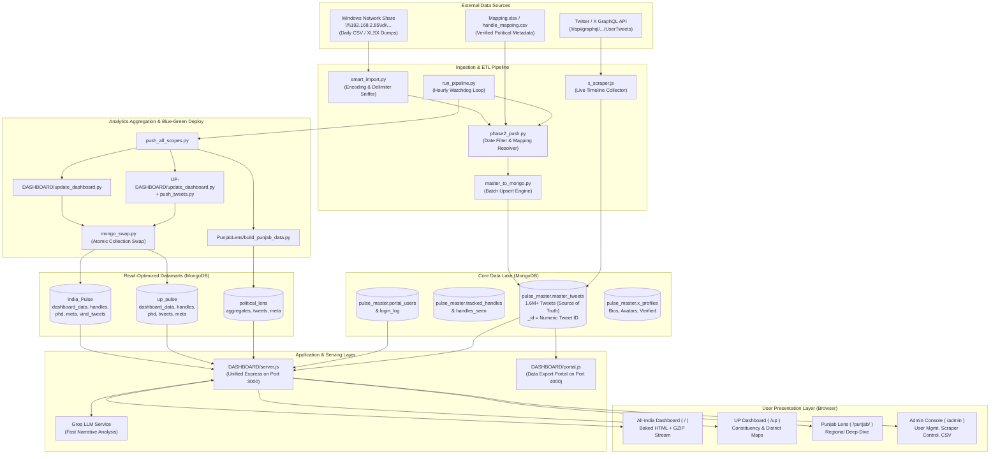
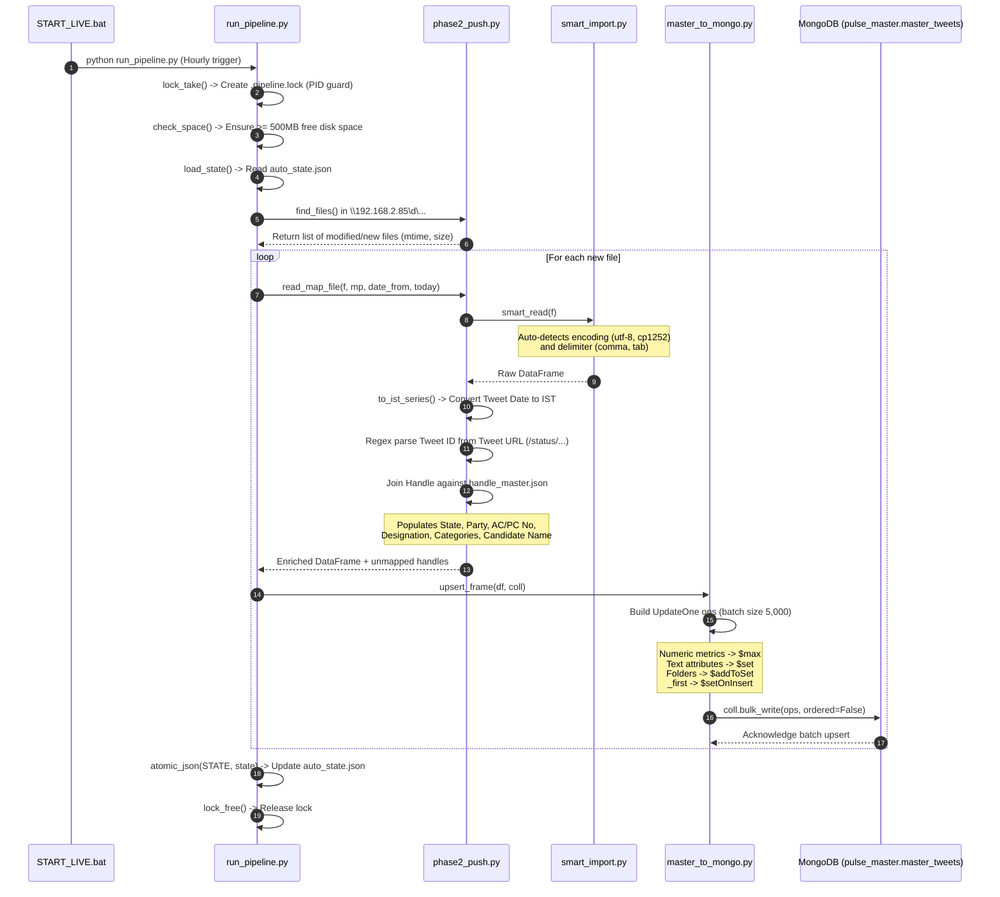

# India Political Pulse & Dashboard System — Technical Analysis

> **Document Type:** Comprehensive Technical Architecture & Codebase Analysis  
> **Target System:** India Political Pulse (All-India, UP-Dashboard, PunjabLens)  
> **Source Directory:** `c:\Main Twitter Project`  
> **Analysis Engine:** Antigravity Senior Full-Stack Engineering Agent  

---

## 1. Project Overview

**India Political Pulse** is an enterprise-scale political intelligence and social media monitoring platform designed to collect, process, enrich, analyze, and visualize high-volume political activity on X (formerly Twitter) across India. 

The system operates continuously on a real-time data pipeline tracking over **1.6+ million tweets**, thousands of verified political leaders (Chief Ministers, Deputy Chief Ministers, Members of Parliament in Lok Sabha & Rajya Sabha, Members of Legislative Assembly, Members of Legislative Council, and Candidates), as well as national media houses and prominent political journalists.

### Core Objectives
1. **Multi-Scope Intelligence**: Provides unified monitoring across three distinct political scopes:
   - **All India Dashboard** (Root `/`): Pan-India political trends, Chief Minister metrics, state-by-state comparisons, and national party share of voice.
   - **Uttar Pradesh Dashboard** (`/up`): Dedicated constituency-level (AC/PC) intelligence, district metrics, and state leader performance for UP.
   - **Punjab Lens** (`/punjab/`): Specialized Punjab political observatory analyzing state-specific parties (AAP, INC, SAD, BJP), regional leaders, and local issues.
2. **Automated Continuous Ingestion**: Ingests multi-source network files (`.csv`, `.xlsx`, `.xlsm`) on an hourly automated loop, augmented by an on-demand and scheduled Twitter GraphQL timeline scraper (`x_scraper.js`).
3. **Master Data Lake & Deduplication**: Maintains `pulse_master.master_tweets` as the definitive single source of truth. Every tweet is deduplicated by its immutable numeric Tweet ID, with metric progression tracked via monotonic ceiling updates (`$max`).
4. **Sentiment & NLP Classification**: Classifies every tweet into an 8-class political sentiment taxonomy (`Pro-BJP`, `Anti-Govt`, `Pro-Govt`, `Positive`, `Neutral`, `Anti-BJP`, `Negative`, `No-Sentiment`), along with bilingual Hindi/English word cloud extraction.
5. **Zero-Downtime Blue/Green MongoDB Deployments**: Rebuilds analytics collections in staging buffers (`<coll>__new`) and executes atomic namespace renames, preventing empty collection windows during data refreshes.
6. **Self-Service Portals & AI Integration**: Offers an administrative console (`/admin`), a standalone Date-Range Data Export Portal on port 4000 (`portal.js`), and LLM-powered narrative Q&A (`/api/ask`) via Groq's API.

---

## 2. Tech Stack & Dependencies

### Core Languages & Environments
- **Node.js**: v18.0.0+ LTS (JavaScript runtime powering the primary Express server, async compression, and GraphQL scraper).
- **Python**: v3.10 - v3.13 (Data processing, ETL pipeline, MongoDB batch operations, sentiment normalization).
- **MongoDB**: Community Server v7.x / v8.x (NoSQL database engine storing master tweets, precomputed analytics, and session data).

### Backend Node.js Dependencies (`DASHBOARD/package.json`, `UP-DASHBOARD/package.json`, `PunjabLens/package.json`)

| Library / Module | Version | Purpose & Usage in Code |
| :--- | :--- | :--- |
| `express` | `^4.19.2` | Web server framework handling routes, authentication guards, compression, static files, and API endpoints. |
| `mongodb` | `^6.8.0` | Official MongoDB Node.js driver providing connection pooling (`mongo_pool.js`), collection queries, and aggregation pipelines. |
| `crypto` *(built-in)* | Native | Cryptographic security: scrypt password hashing (`auth_lib.js`), timing-safe comparisons, and HMAC session token signing. |
| `zlib` *(built-in)* | Native | High-performance GZIP stream compression for dynamic HTML payloads (reducing ~6MB pages to ~1.6MB) and JSON responses. |
| `https` / `http` *(built-in)* | Native | Direct network HTTP client utilized by `x_scraper.js` for querying Twitter's internal GraphQL endpoints without third-party SDK overhead. |
| `fs` / `path` *(built-in)* | Native | Filesystem I/O for reading templates, state locks, geojson spatial files, and secret configurations. |

### Python Dependencies (`DASHBOARD`, `PunjabLens/requirements.txt`, Root Scripts)

| Library / Module | Minimum Version | Purpose & Usage in Code |
| :--- | :--- | :--- |
| `pymongo` | `>=4.6.0` | MongoDB Python driver for batch upserts (`bulk_write`, `UpdateOne`), collection renaming (`mongo_swap.py`), and atomic operations. |
| `pandas` | `>=2.0.0` | High-throughput tabular data manipulation, chunked CSV parsing, IST datetime conversions, and handle normalization. |
| `openpyxl` | Latest | Engine for reading and writing `.xlsx` and `.xlsm` files from network storage and mapping spreadsheets. |
| `playwright` | Latest | Headless browser automation library utilized by `facebook_scraper_fixed.py` and `instagram_scraper_fixed.py`. |
| `textblob` | Latest | Natural language sentiment baseline utilized in fallback NLP scripts. |

### External Third-Party Services & Integrations

| Service / Tool | Purpose | Integration Details |
| :--- | :--- | :--- |
| **Groq Cloud API** | Fast LLM Inference for AI Dashboard Assistant | Called via HTTPS (`https://api.groq.com/openai/v1/chat/completions`) using OpenAI-compatible payload format. Evaluates pre-aggregated JSON figures. Configured in `DASHBOARD/ai_config.json`. |
| **Twitter / X GraphQL** | Live handle timeline scraping | Direct GraphQL API consumption (`/i/api/graphql/pQHADmT91zIY83UbK0x4Lw/UserTweets`) using session cookies (`auth_token`, `ct0`). Configured in `DASHBOARD/x_config.json`. |
| **ngrok** | Secure Public Tunneling | Exposes local ports 3000 (dashboard) and 4000 (data portal) over public HTTPS URLs. Automated in `START_LIVE.bat`. |
| **Windows Network Share (SMB)** | Primary Scraper Raw Data Source | UNC path `\\192.168.2.85\d\Tweeter Data Social Media (25-07-2026)` polled hourly for new scraping dumps. |

---

## 3. Folder Structure & Subsystem Breakdown

```
c:\Main Twitter Project\
├── db_config.json                     # Central MongoDB connection configuration file
├── mongo_conf.py                      # Python central MongoDB configuration resolver
├── README.md                          # Master project documentation and quickstart guide
├── COMMANDS.md                        # Operational cheatsheet for Primary and Secondary machines
├── RESET_MONGO.py                     # Safe database purge utility for clean re-installations
├── mongo_backup.py                    # JSON-based collection dump and restore utility
├── BACKUP_MONGO.bat                   # Batch wrapper for mongo_backup.py
├── SETUP.bat / FRESH_SETUP.py         # Initial deployment & database bootstrap scripts
├── handle_mapping.csv                 # Master handle mapping table (All-India)
├── handle_mapping_UP.csv              # UP-specific handle mapping table
├── India_Major_Towns.geojson          # Geographic boundaries for Indian major towns
├── India_States_medium.geojson        # State boundary geo-vectors for interactive maps
├── India_State_Capitals.geojson       # Geographic points for Indian state capitals
├── UP_Districts.geojson               # Vector polygon boundaries for 75 Uttar Pradesh districts
│
├── DASHBOARD/                         # PRIMARY APPLICATION SERVER & ALL-INDIA DASHBOARD
│   ├── server.js                      # Master Express server (Port 3000) serving /, /up, /punjab, /admin
│   ├── mongo_pool.js                  # Centralized MongoDB connection pool for Node.js
│   ├── mongo_conf.js                  # JavaScript connection resolver linking to ../db_config.json
│   ├── auth_lib.js                    # Scrypt hashing, constant-time validation, and HMAC cookies
│   ├── auth_secret.json               # Generated persistent cryptographic HMAC secret
│   ├── dashboard.template.html        # All-India SPA template with dynamic data placeholders
│   ├── x_scraper.js                   # In-process Twitter GraphQL UserTweets scraper
│   ├── tracker_section.js             # UI module rendering Handle Tracker dashboard tabs
│   ├── news_lib.js                    # Categorization and ranking engine for media/journalist tweets
│   ├── report_lib.js                  # Deep-dive political report generation library
│   ├── run_pipeline.py                # Hourly master ingestion loop, synchronization, and backup
│   ├── phase2_push.py                 # Network directory scanner, date filter, and mapping applicator
│   ├── master_to_mongo.py             # Mongo-first batch upsert engine with $max/$set merge logic
│   ├── push_all_scopes.py             # Orchestrator building All-India, UP, and Punjab views
│   ├── update_dashboard.py            # Aggregation compiler producing dashboard_data.json
│   ├── mongo_swap.py                  # Zero-downtime blue/green collection staging and rename swap
│   ├── src_chunks.py                  # Chunked streaming reader supporting both MongoDB and CSV
│   ├── smart_import.py                # Multi-encoding, delimiter-sniffing CSV/XLSX reader
│   ├── safe_write.py                  # Atomic disk writer with temp file rename and disk space checks
│   ├── fetch_x_profiles.py            # Profile scraper updating bios, avatars, and follower counts
│   ├── daily_report.py                # Automated daily HTML summary email/file generator
│   ├── portal.js                      # Standalone Date-Range Data Download Portal (Port 4000)
│   ├── START_LIVE.bat                 # One-click execution batch starting MongoDB, server, and pipeline
│   ├── RUN_SERVER.bat                 # Server watchdog restart loop
│   └── data/                          # Cached data blobs, handle masters, and backup splits
│       ├── handle_master.json         # In-memory dictionary of verified handle metadata
│       └── dashboard_data.json        # Precomputed All-India KPI and chart payload
│
├── UP-DASHBOARD/                      # UTTAR PRADESH SPECIALIZED DASHBOARD SUBSYSTEM
│   ├── server.js                      # Standalone UP Express server (also mountable by root)
│   ├── dashboard.template.html        # UP SPA template featuring district and AC/PC maps
│   ├── update_dashboard.py            # Aggregator compiling UP-filtered tweets into up_pulse
│   ├── push_tweets.py                 # Pushes raw UP + Media tweets into up_pulse.tweets for keyword search
│   ├── mongo_swap.py                  # Zero-downtime collection swapper for up_pulse
│   ├── report_lib.js                  # Constituency-level reporting library for UP
│   ├── make_up_base.py                # Base dataset generator for Uttar Pradesh
│   └── dual_role_seats.csv            # Edge-case mapping for politicians holding dual offices
│
├── PunjabLens/                        # PUNJAB POLITICAL LENS SUBSYSTEM
│   ├── server.js                      # Express application for PunjabLens (mounted at /punjab/)
│   ├── build_punjab_data.py           # Compiles pulse_master.master_tweets into political_lens
│   ├── aggregate.js                   # Real-time on-the-fly aggregation engine for custom date ranges
│   ├── config.json                    # Configuration for source and target DBs (political_lens)
│   ├── public/                        # Frontend client bundle (HTML, CSS, vanilla JS)
│   ├── START.bat                      # Standalone launch script for PunjabLens
│   └── UPDATE_DATA.bat                # Manual push script for PunjabLens
│
└── mongo_dump_py/                     # Backups and raw MongoDB collection dumps
```

---

## 4. Overall Architecture

The system implements a **Hub-and-Spoke Data Architecture**. The central "Hub" is the raw master data lake stored in `pulse_master.master_tweets`. The "Spokes" are specialized, read-optimized analytical databases (`india_Pulse`, `up_pulse`, `political_lens`), served through a unified Express web application.



---

## 5. Dashboard Pages & Features

The dashboard application is served as an ultra-fast, pre-rendered Single Page Application (SPA). To deliver maximum performance over standard broadband and mobile networks, analytical blobs are computed during the push phase, baked directly into `dashboard.template.html`, and served over an asynchronous GZIP stream.

### Navigation Tabs (`data-tab`) and Functional Scope

| Tab ID | Tab Display Name | Functional Description | APIs / Data Sources Used |
| :--- | :--- | :--- | :--- |
| `dashboard` | **Overview Dashboard** | Primary executive KPI summary: Total Tweets, Total Impressions, Engagement Rates, Party Share of Voice, Daily Tweet Volume bar charts, and Level Breakdown cards (CM, MP, MLA). | Reads embedded `UNI`, `AGG`, and `D` objects from `india_Pulse.dashboard_data`. Filterable client-side by date range (`dashFrom`, `dashTo`). |
| `top-leaders` | **Top Leaders** | Ranked leaderboard of top-performing political leaders by total views, likes, retweets, and follower count. Features filterable cards by designation (CM, Dy CM, LS MP, RS MP, MLA). | Populated via `UNI.allHandles` and `india_Pulse.handles`. Includes profile image integration from `pulse_master.x_profiles`. |
| `states-cm` *(All-India)* | **States & CM Overview** | Interactive India choropleth map. Clicking any state displays state political summary, CM/Dy CM cards, party representation, and sentiment breakdown. | Fed by `CM_DATA` and `STATE_DATA` in `india_Pulse.dashboard_data`, joined with client-side `India_States_medium.geojson`. |
| `up` *(UP Dashboard)* | **UP Constituency Map** | Detailed district-wise and Assembly Constituency (AC) / Parliamentary Constituency (PC) interactive map for Uttar Pradesh. | Embedded in `UP-DASHBOARD/dashboard.template.html`. Renders `UP_Districts.geojson` and constituency summaries. |
| `mla-tracker` | **MLA Tracker** | Searchable directory tracking every sitting MLA and MLC across states. Filterable by party, state, and sentiment trends. | Renders `india_Pulse.handles` with level filtering (`MLA`, `MLC`). |
| `hashtags` | **Hashtag Analytics** | Top trending political hashtags, total tweet volumes, reach metrics, and sentiment distribution per hashtag. | Precomputed `HASHTAGS` and `HTFULL` collections in `dashboard_data`. Endpoint `/admin/hashtags`. |
| `sentiment` | **8-Class Sentiment** | Deep-dive sentiment matrix. Breaks down political discourse into 8 categories: `Pro-BJP`, `Anti-Govt`, `Pro-Govt`, `Positive`, `Neutral`, `Anti-BJP`, `Negative`, `No-Sentiment`. | Precomputed `UNI.sent` and daily sentiment progression arrays in `dashboard_data`. |
| `parties` | **Party Analysis** | Comparative benchmarks between major political alliances and parties (NDA/BJP, INDIA/INC, AAP, SP, BSP, Regional). Analyzes volume vs. sentiment. | Precomputed `PARTY_DATA` in `dashboard_data`. |
| `growth` | **Account Growth** | Time-series follower growth tracking over time. Tracks net follower gains/losses for prominent handles. | Reads `Twitter_Growth_Log.csv` and historical handle snapshots. |
| `profiles` | **Profile Explorer** | Comprehensive handle dossier displaying bios, joining dates, verified badges, follower counts, and historical posting volume. | Reads `pulse_master.x_profiles` and `handles`. |
| `reports` | **Political Reports** | Deep-dive search engine allowing users to query tweets by keyword, politician level, date window, and party. | Calls `report_lib.js` querying `up_pulse.tweets` or `pulse_master.master_tweets`. |
| `tweets` | **Viral Tweets Feed** | Live stream of top-ranking viral tweets sorted by views and retweets. Includes embedded tweet preview links. | Calls `/api/tw/top` and `/api/tw/list` querying `india_Pulse.viral_tweets`. |
| `breaking` | **Breaking News** | Real-time political news stream automatically extracted from over 325,000 Media House and Journalist tweets. Classifies into 14 topics (Elections, Crime, Economy, etc.). | Handled by `news_lib.js` querying `pulse_master.master_tweets` where `Category IN ['Media House', 'Journalist']`. |
| `wordcloud` | **Word Cloud** | Bilingual keyword frequency visualization highlighting trending topics in Hindi (Devanagari script) and English. | Precomputed `WORDCLOUD` frequency map extracted via regex in `update_dashboard.py`. |
| `handle-analytics` | **Handle Deep Dive** | Granular analytics for individual handles: posting cadence, top tweets, hourly activity distribution, and sentiment split. | Dynamically queries `/api/ha/analytics`, `/api/ha/tweets`, and `/api/ha/profile`. |
| `handle-req` | **Request Handle** | User form allowing dashboard users to request new political handles to be tracked by the ingestion team. | Submits POST to `/api/handle-request/submit` storing in `pulse_master.access_requests`. |

---

## 6. Authentication & Authorization Flow

The application implements a custom, zero-dependency, tamper-resistant authentication system built entirely using Node.js native `crypto` in `DASHBOARD/auth_lib.js`.

```mermaid
sequenceDiagram
    autonumber
    actor User as Client Browser
    participant Server as DASHBOARD/server.js
    participant Auth as auth_lib.js
    participant DB as MongoDB (pulse_master)

    User->>Server: POST /login (email, password)
    Server->>Auth: checkThrottle(ip, email)
    alt Too many failed attempts
        Auth-->>Server: Rejected (429 Rate Limit)
        Server-->>User: "Too many attempts. Please wait."
    else Allowed
        Server->>DB: Query portal_users for email
        alt Found in DB
            DB-->>Server: Return user doc (scrypt hash, salt, role)
            Server->>Auth: verifyPw(storedHash, plainPassword)
            alt Password Valid
                opt Legacy Plaintext Password
                    Server->>Auth: hashPw(plainPassword)
                    Server->>DB: Update user doc to scrypt hash
                end
            end
        else Fallback to Hardcoded USERS
            Server->>Auth: verifyPw(hardcodedPw, plainPassword)
        end

        alt Verification Successful
            Server->>Auth: issue(AUTH_SECRET, role, email)
            Note over Auth: Creates signed cookie:<br/>role~email.timestamp.HMAC_SHA256
            Server->>DB: Insert login_log (email, ok=true, ip, ua)
            Server-->>User: Set-Cookie: pulse_auth=...; Path=/; HttpOnly
            Server-->>User: Redirect to homeFor(role)
        else Invalid Credentials
            Server->>DB: Insert login_log (email, ok=false, ip, ua)
            Server-->>User: Redirect /login?e=1
        end
    end

    Note over User, Server: Subsequent Authenticated Requests
    User->>Server: GET /up (Cookie: pulse_auth=...)
    Server->>Auth: parse(AUTH_SECRET, cookie, _revoked)
    Auth->>Auth: Verify HMAC signature (constant-time)
    Auth->>Server: Check if email deactivated or pwChangedAt > cookieTimestamp
    alt Session Valid & Role Authorized
        Server-->>User: Render Requested Scope
    else Session Revoked / Unauthorized
        Server-->>User: Clear-Cookie & Redirect /login
    end
```

### Role Matrix & Access Permissions

| Role Name | Default Landing (`homeFor`) | Permitted Scopes & Routes | Prohibited Routes |
| :--- | :--- | :--- | :--- |
| `admin` | `/` (All-India) | Full access to `/`, `/up`, `/punjab/`, `/admin`, `/api/*`, Handle Tracker, and Port 4000 Data Portal. | None. Unrestricted administrative superuser. |
| `all` | `/` (All-India) | Access to `/` (All-India Dashboard), `/api/tw/*`, `/api/news/*`, `/api/ha/*`. | Prohibited from `/up`, `/punjab/`, and `/admin`. |
| `up` | `/up` (Uttar Pradesh) | Access to `/up` (UP Dashboard), `/api/tw/*`, `/api/report`, `/api/news/*`. | Prohibited from `/` (All-India), `/punjab/`, and `/admin`. |
| `punjab` | `/punjab/` (PunjabLens) | Access to `/punjab/` and PunjabLens API endpoints (`/punjab/api/*`). | Prohibited from All-India, UP, and `/admin`. |
| `backend` | `/admin` (Admin Panel) | Access to `/admin`, raw CSV exports, hashtag detail, mapping sync, and scraping status. | Prohibited from standard dashboard visualizations unless granted dual role. |

---

## 7. MongoDB Schema Reference

The system utilizes **4 distinct MongoDB databases**. The schemas, constraints, field types, and indexing strategies are defined below.

### Database 1: `pulse_master` (Master Data Lake)

#### Collection: `master_tweets` (Primary Source of Truth)
- **Primary Key (`_id`)**: String — Unique numeric Tweet ID extracted from URL.
- **Deduplication Strategy**: Immutable `_id` prevents duplicate tweets.
- **Conflict Resolution**: Monotonic ceiling (`$max`) for numeric metrics; non-blank assignment (`$set`) for text columns.

| Field Name | BSON Type | Required | Default | Description & Constraints |
| :--- | :--- | :--- | :--- | :--- |
| `_id` | String | Yes | None | Unique numeric Tweet ID (e.g. `"1841234567890123456"`). |
| `Handle` | String | Yes | `""` | Author's Twitter screen name (without `@`). |
| `Tweet URL` | String | Yes | `""` | Full canonical URL of the tweet. |
| `Tweet ID` | String | Yes | `""` | Redundant string copy of the Tweet ID. |
| `Tweet Date` | String | Yes | `""` | Normalized timestamp: `"YYYY-MM-DD HH:MM:SS IST"`. |
| `Tweet Text` | String | No | `""` | Full unclipped text of the tweet. |
| `Followers` | Int32 / Int64 | No | `0` | Author follower count at time of scrape (`$max`). |
| `Followings` | Int32 / Int64 | No | `0` | Author following count (`$max`). |
| `Date of Joining` | String | No | `""` | Twitter account creation date. |
| `Total Posts` | Int32 / Int64 | No | `0` | Total cumulative posts on account (`$max`). |
| `Total Comments`| Int32 / Int64 | No | `0` | Total reply count on tweet (`$max`). |
| `Total Likes` | Int32 / Int64 | No | `0` | Total like count on tweet (`$max`). |
| `Total Retweets`| Int32 / Int64 | No | `0` | Total retweet count on tweet (`$max`). |
| `Total Views` | Int32 / Int64 | No | `0` | Total impression/view count on tweet (`$max`). |
| `Total Bookmark Tweets Times` | Int32 / Int64 | No | `0` | Total bookmark count on tweet (`$max`). |
| `Sentiment` | String | No | `""` | Raw sentiment string (`Positive`, `Negative`, `Pro-BJP`, etc.). |
| `Sentiment Score` | String / Double | No | `""` | Numerical sentiment weight or polarity. |
| `State` | String | No | `""` | State of political constituency (blank for media/journalists). |
| `Locations` | String | No | `"-"` | District, region, or city name. |
| `AC/PC No` | String | No | `"-"` | Constituency identifier (e.g. `"AC_80"`, `"PC_12"`). |
| `AC Name` | String | No | `"-"` | Assembly Constituency name. |
| `PC Name` | String | No | `"-"` | Parliamentary Constituency name. |
| `Designation` | String | No | `""` | Political office (e.g. `"MLA"`, `"Chief Minister"`, `"LS_MP"`). |
| `Candidate Name`| String | No | `""` | Full legal name of the politician. |
| `Category` | String | No | `""` | Primary classification (e.g. `"Politician"`, `"Media House"`). |
| `Categories` | Array[String] | No | `[]` | Multi-label array of all tags assigned to this handle. |
| `Party` | String | No | `"-"` | Political affiliation code (`BJP`, `INC`, `AAP`, `SP`, etc.). |
| `Status` | String | No | `"Active"` | Handle status. |
| `Source Folders`| Array[String] | No | `[]` | Array of all network folder names containing this tweet. |
| `_first` | String | Yes | Today | Date string (`YYYY-MM-DD`) when tweet was first ingested. |

**Indexes on `master_tweets`:**
1. `{ "Tweet Date": 1 }` — Accelerated date-range slicing for daily aggregations.
2. `{ "State": 1 }` — Fast state-level isolation (e.g., filtering UP or Punjab).
3. `{ "Handle": 1 }` — High-speed lookups for Handle Analytics.
4. `{ "Category": 1 }` — Media House and Journalist filtering for Breaking News.
5. `{ "Party": 1 }` — Party-level aggregations and comparative charting.
6. `{ "Source Folders": 1 }` — Multi-key index tracking folder origins.

#### Other Collections in `pulse_master`
- **`portal_users`**: User records (`email` [_id], `name`, `pw` [scrypt hash], `role`, `cap`, `createdAt`, `pwChangedAt`, `deactivated`).
- **`login_log`**: Security audit log (`t`, `email`, `ok`, `role`, `ip`, `ua`, `msg`).
- **`access_requests`**: Access application submissions (`email`, `name`, `org`, `phone`, `status`, `createdAt`).
- **`x_profiles`**: Cached profile intelligence (`_id` [handle], `avatar`, `banner`, `bio`, `followers`, `verified`, `updatedAt`).
- **`tracked_handles`**: Real-time scraper queue (`_id` [handle], `active`, `addedBy`, `addedAt`, `lastScraped`, `totalScraped`).
- **`pending_tweets` / `pending_handles`**: Staging buffer for unmapped handles diverted by `map-gate`.

---

### Database 2: `india_Pulse` (All-India Analytical Datamart)

- **`dashboard_data`**: Precomputed analytical JSON structures (`_id`: string name):
  - `UNI`: Master rollup containing total tweet count, total engagement, level breakdown, party shares, and handle indices.
  - `STATE_DATA`: State-by-state political metrics and CM profiles.
  - `PARTY_DATA`: Matrix of party volume, sentiment distribution, and engagement.
  - `AGG` / `DAILY_DATA`: Daily historical progression arrays for charting.
  - `CM_DATA`: Chief Minister and Deputy Chief Minister ranking tables.
  - `HASHTAGS` / `HTFULL`: Top hashtag volumes and sentiment distributions.
  - `WORDCLOUD`: Bilingual word frequency table.
- **`handles`**: Verified leader documents (`_id`: handle, `name`, `party`, `level`, `views`, `likes`, `tweets`, `rts`, `followers`, `score`). Indexes: `{ level: 1 }`, `{ party: 1 }`, `{ level: 1, party: 1 }`, `{ views: -1 }`.
- **`level_map`**: Precomputed index mapping designation level (`_id`: `"MLA"`, `"LS MP"`, `"CM"`, etc.) to an array of matching handles.
- **`phd`**: Party-Hourly-Daily documents used by client-side interactive charts.
- **`viral_tweets`**: Top 1,000 viral tweets sorted by impressions and retweets.
- **`meta`**: Build heartbeat document `{"key": "lastUpdate", "value": "YYYY-MM-DD HH:MM:SS"}`.

---

### Database 3: `up_pulse` (Uttar Pradesh Datamart)

- **`dashboard_data`**: Identical schema structure to `india_Pulse`, but pre-filtered exclusively for Uttar Pradesh political entities, incorporating district-level geometries and AC/PC metrics.
- **`handles`**: UP-only verified politicians.
- **`level_map`**: UP-only level mappings.
- **`phd`**: UP party hourly/daily time-series blocks.
- **`tweets`**: Specialized keyword search pool containing all UP political tweets plus national Media House and Journalist tweets. Optimized for `/api/report`. Indexes: `{ party: 1 }`, `{ date: 1 }`, `{ cat: 1 }`, `{ h: 1 }`.
- **`meta`**: Last update timestamp.

---

### Database 4: `political_lens` (PunjabLens Datamart)

- **`tweets`**: Filtered Punjab political tweets (`_id`: numeric Tweet ID, `handle`, `date`, `text`, `party`, `views`, `likes`, `retweets`, `sentiment`).
- **`aggregates`**: Precomputed summary blocks (`_id`: `"summary"`, `"parties"`, `"leaders"`, `"topics"`, `"timeline"`, `"sentiment"`).
- **`meta`**: Build timestamp and tweet volume count.

---

## 8. Data Flow into MongoDB (End-to-End Traces)

### Flow 1: Network File Ingestion to Master Data Lake (`run_pipeline.py`)



### Flow 2: Zero-Downtime Blue/Green Push (`mongo_swap.py`)

When aggregating analytical databases (`india_Pulse` and `up_pulse`), deleting records directly via `delete_many({})` would create a downtime window where queries return HTTP 500. The system overcomes this using `mongo_swap.py`.

```mermaid
sequenceDiagram
    autonumber
    participant Agg as update_dashboard.py
    participant Swap as mongo_swap.py
    participant DB as MongoDB (india_Pulse)

    Agg->>Agg: Compute handles, phd, mapping, dashboard_data docs
    Agg->>Swap: swap_many(db, [("handles", docs), ("dashboard_data", docs), ...])
    
    loop For each collection in batch
        Swap->>DB: Drop any existing coll__new
        Swap->>DB: Bulk insert docs into coll__new (batches of 5,000)
        Swap->>DB: count_documents(coll__new)
        alt Document count mismatch
            Swap->>DB: Drop coll__new
            Swap-->>Agg: Raise ValueError (Aborts swap; live collection untouched)
        else Count verified
            Swap->>DB: create_index() on coll__new (pre-indexing)
        end
    end

    Note over Swap, DB: Atomic Namespace Swap (Metadata Operation ~2ms)
    loop For each verified collection
        Swap->>DB: Drop any residual coll__old
        opt Live collection exists
            Swap->>DB: Rename coll -> coll__old
        end
        Swap->>DB: Rename coll__new -> coll (NOW LIVE)
        Swap->>DB: Drop coll__old
    end
    Swap-->>Agg: Swap complete, 0 downtime
```

### Flow 3: Live Twitter GraphQL Timeline Scraper (`x_scraper.js`)

1. **Trigger**: Background timer in `server.js` or manual trigger via POST `/admin/tracker/run`.
2. **Handle Queue**: Queries `pulse_master.tracked_handles` where `active == true`.
3. **Execution**:
   - `x_scraper.js` issues HTTP GET requests to Twitter GraphQL:
     `https://x.com/i/api/graphql/pQHADmT91zIY83UbK0x4Lw/UserTweets?variables={userId, count: 40}`
   - Header authentication supplied from `x_config.json` (`auth_token`, `ct0`).
4. **Validation (`map-gate`)**:
   - Every scraped tweet is checked against `mapping_lib.js`.
   - **If Handle is Mapped**: Transformed into canonical schema and upserted directly into `pulse_master.master_tweets` via `bulkWrite` using identical merge rules (`$max`, `$set`, `$addToSet`).
   - **If Handle is Unmapped**: Diverted into `pulse_master.pending_tweets` and `pulse_master.pending_handles`. Unmapped tweets are quarantined from `master_tweets` until mapped via the Admin Panel.

---

## 9. Comprehensive API Endpoint Reference

All routes are defined in `DASHBOARD/server.js`, `UP-DASHBOARD/server.js`, `PunjabLens/server.js`, and `DASHBOARD/portal.js`.

### Authentication & Session Routes

| Method | Endpoint Path | Auth Guard | Description | MongoDB Collections Touched |
| :--- | :--- | :--- | :--- | :--- |
| `GET` | `/login` | Public | Renders the login form. | None. |
| `POST` | `/login` | Public (Throttled) | Validates credentials via `auth_lib.js`, sets HMAC cookie, logs access. | `pulse_master.portal_users` (R), `pulse_master.login_log` (W). |
| `GET` | `/logout` | Public | Clears `pulse_auth` cookie and redirects to `/login`. | None. |
| `POST` | `/request-access` | Public | Submits access application. | `pulse_master.access_requests` (W). |
| `GET` | `/set-password` | Token Guard | Form to set password from invitation. | `pulse_master.portal_users` (R). |
| `POST` | `/set-password` | Token Guard | Sets new scrypt-hashed password. | `pulse_master.portal_users` (W). |

### Dashboard & Presentation Routes

| Method | Endpoint Path | Auth Guard | Description | MongoDB Collections Touched |
| :--- | :--- | :--- | :--- | :--- |
| `GET` | `/` | `dashGuard` (role: all, admin) | Serves All-India Dashboard with baked data over GZIP stream. | `india_Pulse.dashboard_data` (R), `india_Pulse.meta` (R). |
| `GET` | `/up` | `dashGuard` (role: up, admin) | Serves UP Dashboard with baked data over GZIP stream. | `up_pulse.dashboard_data` (R), `up_pulse.meta` (R). |
| `USE` | `/punjab/*` | `allowScope('punjab')` | Mounts PunjabLens application. | `political_lens.aggregates` (R), `political_lens.tweets` (R). |
| `GET` | `/refresh` | `adminGuard` | Invalidates in-memory HTML cache and rebuilds dashboard pages. | `india_Pulse.dashboard_data` (R). |
| `GET` | `/api/version` | Public | Returns `{ lastUpdate, count }` for client polling auto-refresh badges. | `india_Pulse.meta` (R). |

### Real-Time Data & Analytics APIs

| Method | Endpoint Path | Auth Guard | Description | MongoDB Collections Touched |
| :--- | :--- | :--- | :--- | :--- |
| `GET` | `/api/live` | `newsGuard` | Fetches live breaking news items. | `pulse_master.master_tweets` (R). |
| `GET` | `/api/news` | `newsGuard` | Paginated, categorised news from Media/Journalist handles. | `pulse_master.master_tweets` (R). |
| `GET` | `/api/tw/top` | `dashGuard` | Returns top viral tweets by impressions. | `india_Pulse.viral_tweets` (R). |
| `GET` | `/api/tw/list` | `dashGuard` | Searchable, paginated tweet explorer. | `pulse_master.master_tweets` (R). |
| `POST` | `/api/ask` | `dashGuard` | Sends computed stats and user prompt to Groq Cloud LLM. | None (Uses client JSON body; strictly no raw DB access). |
| `GET` | `/api/ai/models` | `dashGuard` | Lists available LLM models from Groq. | None. |
| `GET` | `/api/report` | `dashGuard` | Advanced political search and report generator. | `up_pulse.tweets` (R). |
| `GET` | `/api/ha/cats` | `dashGuard` | Handle Analytics: Lists available designation categories. | `india_Pulse.handles` (R). |
| `GET` | `/api/ha/handles` | `dashGuard` | Handle Analytics: Filtered list of handles in category. | `india_Pulse.handles` (R). |
| `GET` | `/api/ha/analytics` | `dashGuard` | Handle Analytics: Granular metrics, KPI cards, cadence. | `pulse_master.master_tweets` (R). |
| `GET` | `/api/ha/tweets` | `dashGuard` | Handle Analytics: Individual handle's tweets. | `pulse_master.master_tweets` (R). |
| `GET` | `/api/ha/profile` | `dashGuard` | Handle Analytics: Bio, avatar, and metadata. | `pulse_master.x_profiles` (R). |

### Admin Console Routes (`/admin`)

| Method | Endpoint Path | Auth Guard | Description | MongoDB Collections Touched |
| :--- | :--- | :--- | :--- | :--- |
| `GET` | `/admin` | `adminGuard` | Serves Backend Admin Console UI. | `pulse_master.portal_users`, `pulse_master.login_log`, `pulse_master.access_requests`. |
| `GET` | `/admin/download` | `adminGuard` | Streams filtered master tweets directly to CSV download. | `pulse_master.master_tweets` (R). |
| `GET` | `/admin/hashtags` | `adminGuard` | Hashtag monitoring table and detail view. | `india_Pulse.dashboard_data` (R). |
| `POST` | `/admin/user-create` | `adminGuard` | Creates new user account with hashed password. | `pulse_master.portal_users` (W). |
| `POST` | `/admin/user-action` | `adminGuard` | Deactivates or activates user accounts. | `pulse_master.portal_users` (W). |
| `POST` | `/admin/user-password` | `adminGuard` | Admin password reset for a user. | `pulse_master.portal_users` (W). |
| `GET` | `/admin/tracker/state` | `adminGuard` | Live execution status of Twitter GraphQL scraper. | In-memory `STATE` & `pulse_master.tracked_handles`. |
| `POST` | `/admin/tracker/run` | `adminGuard` | Manually triggers Twitter scraper pass. | `pulse_master.tracked_handles` (R), `master_tweets` (W). |
| `POST` | `/admin/tracker/stop` | `adminGuard` | Halts currently running scraper. | In-memory `STATE`. |
| `POST` | `/admin/tracker/add` | `adminGuard` | Adds new handle to tracker queue. | `pulse_master.tracked_handles` (W). |
| `POST` | `/admin/tracker/map` | `adminGuard` | Resolves mapping for pending handle; releases held tweets. | `pending_tweets` (R), `master_tweets` (W). |

---

## 10. Environment Variables & Secret Configurations

The system prioritizes local JSON configuration files with fallback to system environment variables. **No secret values are hardcoded in environment definitions.**

| Configuration Key / File | Format / Location | Purpose |
| :--- | :--- | :--- |
| `mongo_url` | `db_config.json` | Master MongoDB connection URI (e.g. `mongodb://localhost:27017` or authenticated URI). Resolvable via `MONGO_URL` env variable. |
| `auth_secret.json` | `DASHBOARD/auth_secret.json` | 64-character hexadecimal cryptographic secret used for signing and verifying HMAC session cookies. Auto-generated on first boot if missing. |
| `ai_config.json` | `DASHBOARD/ai_config.json` | Groq Cloud API credentials: `{ "key": "<GROQ_API_KEY>", "model": "llama-3.3-70b-versatile" }`. |
| `x_config.json` | `DASHBOARD/x_config.json` | Twitter/X session cookies required by `x_scraper.js`: `{ "auth_token": "...", "ct0": "..." }`. |
| `local_config.json` | `DASHBOARD/local_config.json` | Laptop role indicator: `{ "role": "secondary" }`. When set to `"secondary"`, network CSV backups and daily network reports are suppressed to prevent file contention with the Primary machine. |
| `PYTHONIOENCODING` | Subprocess Env (`run_pipeline.py`) | Set to `utf-8` to prevent Windows `cp1252` encoding crashes on non-ASCII characters (e.g. `→`). |
| `PYTHONUTF8` | Subprocess Env (`run_pipeline.py`) | Set to `1` to enforce UTF-8 mode across all Python child processes. |

---

## 11. How to Run & Deploy

### Prerequisites
1. **Node.js LTS (v18+)**: Verify with `node -v`.
2. **Python (v3.10 - v3.13)**: Must be registered in system PATH (`python --version`).
3. **MongoDB Community Server**: Running as a Windows Service (`net start MongoDB`).
4. **Network Share Access**: Verify connectivity to `\\192.168.2.85\d\Tweeter Data Social Media (25-07-2026)`.

### Initial Setup (One-Time)
```cmd
cd /d "C:\Main Twitter Project"

REM 1. Install Node.js dependencies
cd DASHBOARD
npm install
cd ..\PunjabLens
npm install
cd ..

REM 2. Install Python dependencies
python -m pip install pymongo pandas openpyxl playwright textblob

REM 3. Restore MongoDB database dump (if setting up a fresh machine)
python mongo_backup.py --restore
```

### Starting the Production Service
To start the live dashboard with automated hourly ETL updates:
```cmd
cd /d "C:\Main Twitter Project\DASHBOARD"
START_LIVE.bat
```
`START_LIVE.bat` executes the following sequence:
1. Starts the local MongoDB service if not already running.
2. Terminates any dangling processes holding port 3000.
3. Launches `RUN_SERVER.bat` in a resilient watchdog loop that restarts `server.js` if it crashes.
4. Initializes the `ngrok` tunnel for remote public access.
5. Launches the user's default browser to `http://localhost:3000`.
6. Enters a persistent 3,600-second (1-hour) loop executing `python run_pipeline.py`, with automatic terminal color switching (Red on failure, Green on recovery).

### Operational URLs
- **All India Dashboard**: `http://localhost:3000/`
- **Uttar Pradesh Dashboard**: `http://localhost:3000/up`
- **Punjab Lens**: `http://localhost:3000/punjab/`
- **Admin Console**: `http://localhost:3000/admin`
- **Data Export Portal**: `http://localhost:4000/` (via `node portal.js` or `START_PORTAL.bat`)

---

## 12. Issues, Security Risks & Recommendations

### Critical Security Vulnerabilities
1. **Hardcoded Base Passwords in Source Code**
   - *File*: `DASHBOARD/server.js` (lines 110-116)
   - *Issue*: Five production accounts (`admin@jarvis.consulting`, `uttarpradesh@jarvis.consulting`, `punjab@jarvis.consulting`, `indiapulse@jarvis.consulting`, `admin_1@jarvis.consulting`) have static plaintext passwords hardcoded directly in `server.js`. Anyone with code access or git clone privileges obtains immediate administrative credentials.
   - *Recommendation*: Migrate hardcoded users into `pulse_master.portal_users` using scrypt hashes via `make_pw_hash.js` and remove the fallback `USERS` dictionary.
2. **Hardcoded Plaintext ngrok Auth Token**
   - *File*: `DASHBOARD/START_LIVE.bat` (line 37)
   - *Issue*: A permanent ngrok authentication token (`3HOwYJbdyIKfkpBijs3GVKLPTKr_...`) is hardcoded in the batch script.
   - *Recommendation*: Move ngrok credentials to standard user environment variables or an untracked `.env` file.
3. **Hardcoded Base Credentials in Standalone Portal**
   - *File*: `DASHBOARD/portal.js` (lines 24-29)
   - *Issue*: `portal.js` contains plaintext passwords for `admin@jarvis.consulting`, `datateam@jarvis.consulting`, and client accounts.
   - *Recommendation*: Refactor `portal.js` to authenticate against `pulse_master.portal_users` using `auth_lib.js`.

### Architectural & Code Quality Concerns
1. **Monolithic `DASHBOARD/server.js` (5,242 Lines)**
   - *Issue*: `server.js` contains Express configuration, GZIP middleware, session validation, route handlers, Admin panel HTML rendering, scraper logic, and report compilation in a single massive file.
   - *Recommendation*: Decompose into modular controllers: `routes/dashboard.js`, `routes/admin.js`, `routes/api.js`, and `controllers/tracker.js`.
2. **Hardcoded Network Paths (UNC Dependency)**
   - *File*: `DASHBOARD/phase2_push.py` (line 27), `run_pipeline.py` (line 34)
   - *Issue*: Direct hardcoding of `\\192.168.2.85\d\...`. If the network subnet changes or the scraping machine's IP re-allocates, the pipeline immediately halts with directory not found errors.
   - *Recommendation*: Externalize network source directories into `db_config.json` or `config.json`.
3. **Large Injected HTML Payloads**
   - *Issue*: The All-India and UP dashboard templates are ~1.1MB to ~1.3MB raw, and with baked JSON data reach ~6MB before GZIP. While GZIP reduces network transfer to ~1.6MB, lower-end client devices and mobile browsers experience DOM parsing delays.
   - *Recommendation*: Transition from full template injection to asynchronous client-side JSON hydration: serve a lean static HTML shell and fetch analytical blobs via streaming JSON endpoints.
4. **Missing Text Indexes on `master_tweets`**
   - *Issue*: Ad-hoc searches in `/api/report` and `/api/tw/list` on `Tweet Text` rely on regex scans across 1.6+ million documents without a text index, resulting in temporary CPU spikes on MongoDB.
   - *Recommendation*: Create a compound text index: `db.master_tweets.createIndex({ "Tweet Text": "text" })`.
